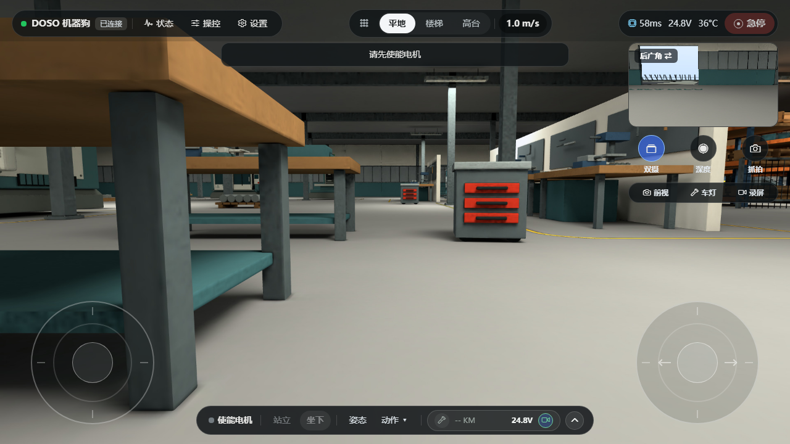
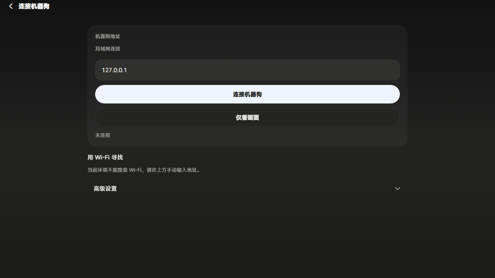
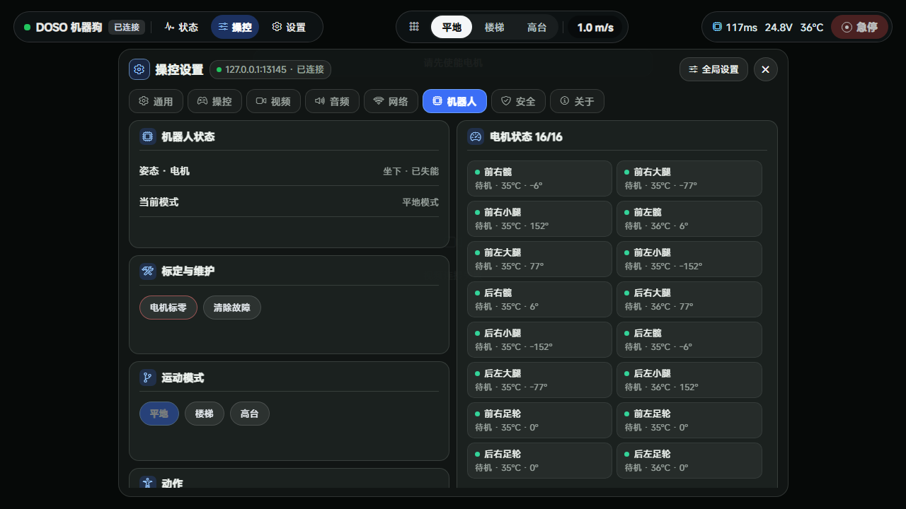
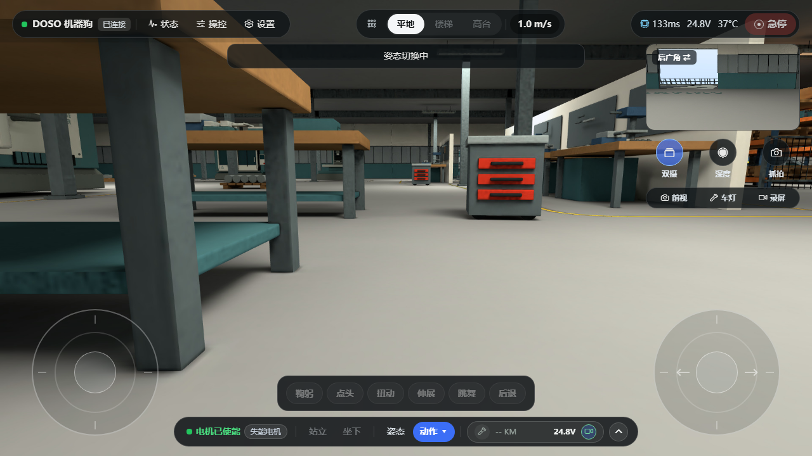
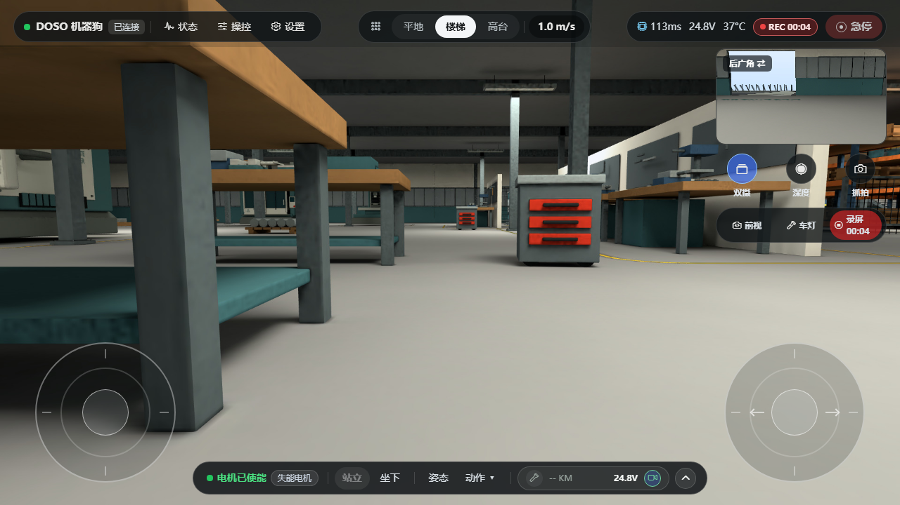
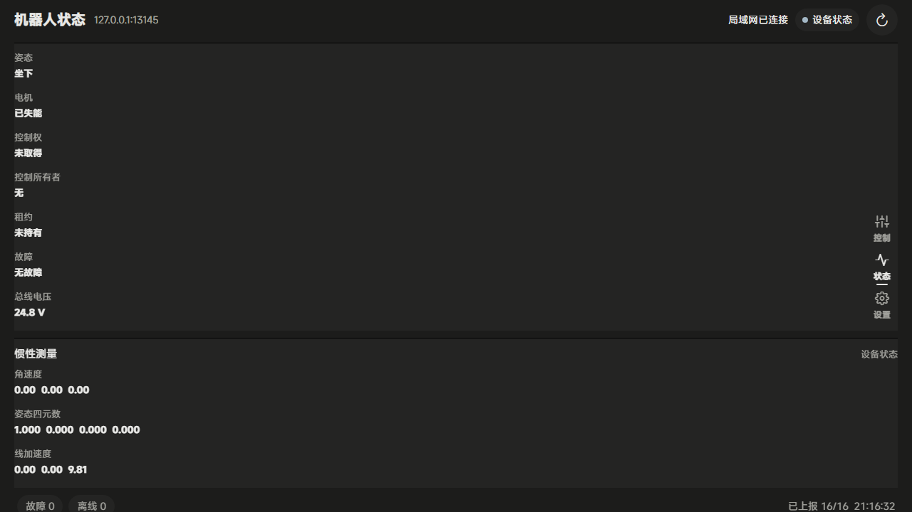

# DOSO App

DOSO 机器狗操控与状态终端（React Native / Expo SDK 57），面向 G20 遥控掌机与移动设备。当前源码版本为 `0.0.1`。

App 启动直达 **三页工作台（控制 / 状态 / 设置）**，底层控制走 **Brainstem gRPC（`:13145`）**，实时双摄画面走 **LingTu WebRTC WHEP / 本地 MuJoCo 推流（`:5050`）**。

---

## 一、页面组成与界面预览

### 1. 主控页（默认首屏）— `ControlScreen` + `controlLandscapeHud`
16:9 全屏主视角 + 右上角双摄/深度画中画（点击互换主副视角）；顶部三座悬浮胶囊岛（设备与导航 / `平地·楼梯·高台` 模式与限速 / 遥测与置顶 `急停`）；左右双虚拟摇杆（支持切换 G20 实体手柄）；底栏集成 `使能/失能电机`、`站立`、`坐下`、`姿态`、`动作 ▾` 与整机仪表盘。



### 2. 连接机器狗页 — `RobotConnectionScreen`
点击左上角设备胶囊呼出，支持输入机器狗局域网 IP（默认端口 `13145`）、扫描机器狗 Wi-Fi 热点或使用 mTLS 配对证书建立控制连接。



### 3. 操控设置浮层 — `ControlReferenceUi`
点击顶栏「操控」直接叠加在实时画面上方（急停保持可用），包含 `通用 / 操控 / 视频 / 音频 / 网络 / 机器人 / 安全 / 关于` 8 个分栏。其中 **「机器人」** 分栏集中提供 **电机标零**、**清除故障**、**运动模式切换**、**预设动作** 与 **16/16 电机实时状态（健康/温度/角度）**。



### 4. 动作触发、模式切换与录屏抓拍运行态
站立态展开底栏「动作 ▾」可触发预设动作；顶栏与设置页均可切换运动模式；右侧工具栏支持一键 1080p 抓拍与录屏（右上角同步显示 `REC` 计时）。

| 预设动作抽屉（`PlayGesture`） | 楼梯模式 + 实时录屏（`REC`） |
| --- | --- |
|  |  |

### 5. 机器人状态页 — `JointStatusScreen`
按四条腿分组只读展示 16 个关节与足轮电机的在线状态、温度、位置与 IMU 姿态；未连接或数据过期时显示 `—` / `未同步`。



### 6. 全局设置页 — `ProfileScreen`
从主控顶栏左岛「设置」或状态页右侧导航轨进入，管理当前机器狗连接摘要、断开连接、外观主题与数据隐私说明（`DataPrivacyScreen`）。

> **其他保留/已下线界面说明**：`DeviceUnavailableScreen`（配网/固件未开放占位说明）与 `BleDiscoveryScreen`（仅扫描附近 BLE 广播尾号）已在源码标记为占位/实验只读；早期登录注册、旧 5-Tab 首页/地图/任务及 `design-qa` 等 30+ 个历史无用页面已下线移除，完整分级清单见 [docs/UI_SOURCE_OF_TRUTH.md](./docs/UI_SOURCE_OF_TRUTH.md)。

---

## 二、控制、模式切换与核心功能达成情况

| 功能模块 | 对应协议 / 接口 | 当前达成状态 | 说明 |
| --- | --- | --- | --- |
| **连接与 16 电机遥测** | `GetControlStatus` / `GetProfile` / `GetMotorStatus` / `GetVoltage` / `ListenImu` | **✅ 已达成** | App + 本地仿真 + G20 真机局域网直连、断线自动重连、16/16 电机状态与母线电压读取均已验证通过 |
| **电机使能 / 失能与急停** | `Enable` / `Disable` / `ReleaseControl` | **✅ 已达成** | 使失能带二次安全确认（G20 真机已验证通过）；置顶软急停无二次确认，立即抢占清零并释放租约 |
| **站立 / 坐下与 50Hz 摇杆行走** | `StandUp` / `SitDown` / `AcquireControl` / `RenewControlLease` / `WalkChecked` | **✅ 控制链路已打通**（仿真闭环通过，真机持续行走待复验） | 触屏双摇杆与 G20 实体手柄均按 50Hz 下发连续速度，松手自动发零速并释放租约，含 150ms 输入看门狗保护；仿真全流程通过，真机持续摇杆运动仍需复测无线链路波动下的 ACK 超时表现 |
| **运动模式切换** | `SwitchProfile`（`平地` / `楼梯` / `高台`） | **✅ 已达成**（仿真闭环通过） | 顶栏胶囊与操控设置页双向可切；强制要求站稳或趴地且无活动运动租约，二次确认后下发并核验 `activeModeId` 回执 |
| **摔倒恢复** | `RobotRecovery`（`Enter` / `Enable` / `Start` / `Heartbeat` / `Cancel` / `Exit`） | **✅ 已达成**（仿真闭环通过） | 接入独立恢复服务与会话心跳保护，稳定起身站立后经 `Exit` 回到常规运动模式 |
| **电机标零与清除故障** | `SetZero` / `ClearMotorFault` | **✅ 已达成**（仿真闭环通过） | 位于「操控 › 机器人 › 标定与维护」；标零强制要求趴地（`Grounded`）无租约并经二次确认，清除故障豁免严重故障锁死以便排障 |
| **预设动作** | `ListGestures` / `PlayGesture` | **✅ 已达成**（仿真闭环通过） | 连接后自动同步动作列表（鞠躬 / 点头 / 扭动 / 伸展 / 跳舞 / 后退），站立使能态一键执行，动作结束后自动恢复站立 |
| **双摄图传、抓拍与录屏** | WebRTC WHEP / 本地 `:5050` 推流 + `useControlMediaCapture` | **✅ 已达成** | 支持前/后双广角与画中画互换，端侧可导出 1080p JPEG 抓拍与 MP4/WebM 录屏文件（Web 下载目录 / Android 系统相册） |

更多阶段构建记录与真机测试细节见 [docs/CURRENT_RELEASE_STATUS.md](./docs/CURRENT_RELEASE_STATUS.md)。

---

## 三、快速启动与验证

```powershell
# 1. 安装依赖
npm install
npm --prefix iot/brainstem-bridge install

# 2. 本地全链路联调（分终端启动：Brainstem 仿真 :13145 + Web 桥 :8121 + MuJoCo 视频 :5050 + Web :8081）
npm run dev:brainstem-sim
npm run dev:web-grpc-bridge
npm run dev:mujoco-video
npm run web -- --port 8081

# 3. 类型与核心回归测试
npm run typecheck
npm run test:control-ui
```
