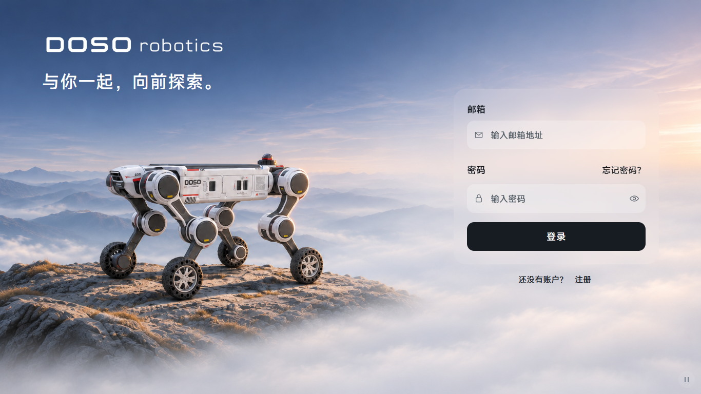

# DOSO 登录界面 · 登顶之后

**用户已于 2026-11-10 确认此版设计。** 这是登录视觉与交互的保留版本，供后续正式 App 接入和内部页面设计参考。

本目录是独立静态预览，不连接账号服务，不会提交邮箱或密码，也没有替换 React Native App 的登录页面。背景为参考 DOSO 轮足机器狗外观制作的 AI 品牌概念图，并非真机登山记录。



[竖屏效果](previews/portrait.png) · [手机横屏](previews/phone-landscape.png) · [动效录屏](previews/motion.webm)

## 打开预览

在仓库根目录运行：

```sh
python -m http.server 4311 --bind 127.0.0.1 --directory designs/summit-login
```

打开 <http://localhost:4311/summit.html>。调整窗口宽度或旋转设备即可切换横竖屏布局，无需 Node、打包工具或后端。

字体遵循本仓库的第三方文件规则，不提交 OTF 二进制。从[小米 MiSans 官方页面](https://hyperos.mi.com/font/zh/download)取得原始 `MiSans-Regular.otf` 与 `MiSans-Medium.otf`，放进本目录的 `assets/`。准确来源和 SHA-256 在 [font-sources.json](assets/font-sources.json)，随附[原始许可](assets/MiSans-License.pdf)。字体仅配合本软件使用，保留 Xiaomi 的版权说明。未安装时页面使用系统字体，排版会略有差异；以上截图记录完整字体下的定稿效果。

## 已确认的内容

- 竖屏采用白色字标与宣传语、完整登顶机器狗、云海中的无描边玻璃表单。
- 横屏采用左侧品牌与场景、右侧表单，使用单独构图的横版背景，不拉伸竖图。
- 横竖屏切换保留已输入内容；提供本地格式校验、密码可见性切换。
- 图片缓慢推近，叠加薄雾和晨光变化；机器人本体没有身体运动动画。
- 支持暂停/继续、后台暂停、系统减少动态。用户暂停不会被前后台切换覆盖。

## 文件职责

| 文件 | 用途 |
| --- | --- |
| `summit.html` | 页面结构与本地预览表单行为 |
| `concepts.css` | 继承的基础字体和表单样式 |
| `summit.css` | 定稿的横竖屏布局及玻璃样式 |
| `summit-motion.css`、`summit-motion.js` | 环境动效与暂停状态 |
| `assets/` | 真实品牌字标、两张概念背景、字体来源及许可 |
| `previews/` | 定稿截图和录屏 |
| `summit-notes.md` | 构图与图像生成提示 |

## 验证与后续接入

浏览器已检查 320×844、430×932、844×390、1024×768、1000×900、1366×768 的布局；验证过旋转保留输入、密码显示切换、本地提交提示、暂停/继续及动态切换“减少动态”。没有横向溢出或浏览器运行错误。

后续将视觉接入正式 App 时，应沿用现有账号认证、MFA、请求并发锁与错误反馈，替换预览占位行为，再验证软键盘、原生模糊和目标手机帧率。本次未做真实账号登录、APK 发布或原生真机验收。
