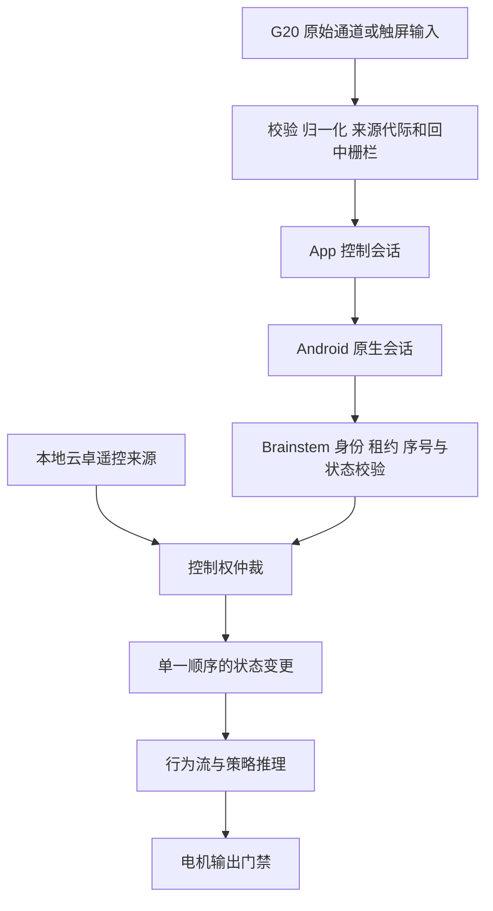

# DOSO 控制执行架构

更新：2026-10-25。适用于当前 DOSO App 与本地 Brainstem 源码。设备安装、机器人部署和物理验收是独立交付环节。

## 本轮范围

优先修正控制执行算法中的时序和生命周期：合法输入经过谁的授权、何时失效、状态如何提交、关闭后什么工作必须退休。不变更 ONNX 策略训练，不猜测硬件未声明的加速度约束。

本轮验收条件：

1. 已释放的仲裁器不再授权、投递普通动作或访问已关闭的状态机。
2. App 没有单调时钟时不使用系统日期判断控制有效期；运动中丢失该时钟会阻止新输入并请求撤销。
3. Brainstem 自己生成的相对遥测使用已有单调计时源；日历起始信息和硬件流时间戳保留各自语义。
4. 状态机一次只提交一个状态变更；异步取消期间的 Fault 不在旧状态上丢失，重复站立不启动两条行为流。
5. 关闭开始后不接收新意图，也不因先前未完成的取消而重新建立行为流。
6. 内部完成事件必须与当前过渡行为的实际订阅对应，旧站立完成不能结束后续坐下。外部历史 `Done` 调用保留兼容语义，不将其描述为已携带来源校验。

## 职责与数据流

| Module | Interface 承担的合同 | 主要代码 |
| --- | --- | --- |
| 输入意图 | 原始通道校准、有效范围、中位、来源代际、授权后新样本；停止保持独立入口 | `g20InputModel.ts`、`useG20Input.ts`、`ControlScreen.tsx` |
| App 控制会话 | 当前连接代际、状态新鲜度、动作就绪、请求序列、不重放授权前输入 | `brainstemControlSession.ts` |
| 原生控制会话 | Android 单调时钟、原始采集时间、限流、租约和 ACK、看门狗、停止确认 | `ControlSession.kt` |
| 机器人入口 | 校验调用身份、租约 token、序号、向量单位、状态与策略切换前提 | `unified_cms_server.dart`、`control_lease.dart` |
| 控制权仲裁 | 云卓优先、gRPC 不能抢占、所有权与安全代际、超时及终态退休 | `control_arbiter.dart` |
| 执行状态机 | 根据当前状态按顺序处理动作、核对内部完成事件来源、关闭时等待订阅清理 | `han_dog_brain/lib/src/cms/cms.dart` |
| 策略事务 | 候选模型加载、提交前复检、原子切换元数据与行为、失败保留旧模型 | `brain.dart`、`profile_manager.dart` |

这些合同分别处理不同风险。App 的显示就绪不代替机器人授权；通信 ACK 不证明机械动作完成。后续 WebRTC 承载通信时，应接在相同控制合同上，不能另开一条绕过租约和仲裁的运动路径。

## 时间、坐标与状态约定

- G20 采集、派发与授权栅栏使用同一台 Android 的 `elapsedRealtime`。JS 的 `performance.now` 只用于自己的状态和输入年龄，不与 Android 或机器人开机时间直接相减。
- App 默认时钟缺失、抛错、负数或非有限值返回不可用；不回退 `Date.now`。UTC 日期仅作日历信息和日志使用。
- Brainstem gRPC 租约使用 `Stopwatch`，服务器自己生成的相对遥测也使用已有 `Stopwatch`。这不是跨设备时钟同步。
- Brainstem 体坐标为 x 向前、y 向左、z 逆时针；App 投影为 `forward=-drive.y*0.20`、`lateral=-drive.x*0.20`、`yawRate=-turn.x*0.30`。右杆水平为角速度 rad/s，右杆 Y 不控制机身动作。
- `commandVersion` 在意图入队时同步变化；策略提交期间新意图仍会撤销旧的提交上下文。顺序处理只等待取消与新订阅建立，不等待整段站立或行走行为结束。

## 从原始材料形成证据

先看真实实现和依赖行为：官方 RCSDK 固定字节、通道与 GET 起点、proto 坐标和单位、原生派发代码、实际 `cms 1.4.4` / Bloc transformer、状态机订阅及取消回调、真实电机出口。历史发布总结只用于定位，不作为本轮通过证据。

本轮反例跨过真实公开 Interface：真实 M 加可控取消流，真实仲裁器加真实 M，生产默认 JS 时钟加可控时间来源，真实服务器遥测接口加离线传感流。测试不执行厂商 JNI、不连接实际电机。保留修改前字节与 SHA256，再记录原实现失败和修复后结果。

本轮原始输出、冻结输入与独立审查位于 `artifacts/release-readiness/20261025-core-control/`。最终有效结果以该目录最新通过的 `verification-N.json` 与 `closeout.json` 为准，阶段测试数量不累加成整机通过数。

服务端遥测测试检查相对时间、起始日历与硬件透传合同；没有注入系统日期跳变。免受日期调整影响的依据是计时来源改为 Stopwatch，不能写成已完成系统时间跳变实测。

## 下一层最优先的问题

### 输出前的时效与控制来源

原始代码中 ONNX `session.run` 同步执行（`behaviour.dart`），租约 Timer 和推理在同一 isolate 调度。当前 `han_dog/bin/han_dog.dart` 的 `nextActionStream` 电机出口检查使能和电机健康，但未携带最后新鲜控制输入的 deadline 或控制来源代际。

下一步先做离线反例：在推理开始后撤销来源或跨过输入有效期，让推理迟到返回，验证该输出不能再进入电机发送。再确定最小输出合同与独立看门狗职责。未取得机器人端/台架证据之前，300ms 租约仅是本地逻辑配置，不能称机械停止上界。

2026-10-25函数设计补充：`han_dog/tool/motion_output_guard_prototype.dart`已实现独立离线`checkMotionOutput`，以不可变permit、本地current以及带clockId的单调读值返回允许或拒绝原因。14项原型和28项既有相关回归通过、严格分析0issue，证据在`artifacts/release-readiness/20261025-output-guard-prototype/`。这仅证明判定合同，不代表上述真实推理/输出反例已接线：当前裸矩阵输出缺少帧凭据，M排队版本不能冒充已应用输入；现有撤销先排零速度再释放owner，安全恢复和无owner保持还需独立来源合同。没有将原型放到默认电机出口，未改生产运行逻辑。

### 通信活跃与新输入分开

当前相同序号、相同 payload 的 `WalkChecked` 重试会续 gRPC 租约，但不续 arbiter。默认超时下，只有重复包可能把300ms保护延长到3s仲裁超时；再有显式续租心跳时两者可继续续期。需单独定义“通信仍在线”和“操作者产生了新鲜输入”，不能把幂等 ACK 当新采样。

这会影响现有客户端协议，先保留兼容，下一批补端到端反例和合同后再改。不能仅通过提高发送频率掩盖 G20 五次 GET 后至少100ms等待的事实，也不能把 GET 起点当硬件 ADC 或无线帧时间证明。

### 有序提交的边界

显式顺序处理修复状态提交竞态，但不为挂起的 `subscription.cancel`、同步推理或队列积压提供时间上界。后续的命令有效期与抢占合同必须在实际输出前复核，最终由独立台架观测与硬件保护证明机身结果。

## 当前交付判断

本轮是源码与离线验证收敛；不构建或安装 APK，不部署 Brainstem，不执行姿态、电机、策略或运动操作。新控制源代码尚未进入获验收的新 G20 安装包。正式发布仍为 NO-GO。
