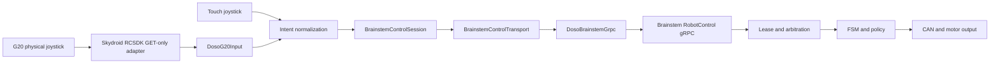

# DOSO single control architecture

Updated: 2026-11-13

This document is the source of truth for the current App-to-robot control path. It is intentionally smaller than a new SDK design: the repository already contains the required seams. New work should deepen these modules and reuse their interfaces instead of adding another transport, session, or status model.

## The one control path



Touch and G20 input are two sources inside the App. They are normalized into the same control session and therefore arrive at Brainstem as one gRPC control session. The robot can independently arbitrate a robot-side remote controller and other gRPC clients; the App must not invent a second robot-side authority model.

The vendor SDK is an input adapter only. It reads G20 channels, channel settings, and control mode. It does not send robot commands. Robot commands use Brainstem gRPC through the DOSO native module.

## The robot is the service provider

The robot-side Brainstem service is the only provider of robot capabilities. It owns the service contract, device state, control authority, lease, policy selection, safety gates, CAN access, and motor output. Every external controller is a client of that service.

```text
Brainstem on the robot
  ├─ App touch client
  ├─ App G20-input client
  ├─ G20/remote-controller client (if the robot-side radio path is enabled)
  └─ Other approved client
```

Skydroid RCSDK belongs only to the second line of the App: it reads the physical G20 controller so DOSO can turn that input into a Brainstem request. It never becomes the robot service, never owns the lease, and never writes motor commands. If a physical remote controller has an independent robot-side radio path, that path is a separate Brainstem input source and must be arbitrated by Brainstem; the Android RCSDK does not represent that robot-side source.

This closes the architecture at one point: clients may collect input and request operations, but only Brainstem may decide whether a request is accepted and only the robot execution layer may produce motor output.

## Canonical modules and seams

| Responsibility | Canonical module | Interface that callers use | Must not be duplicated in |
| --- | --- | --- | --- |
| Vendor G20 input | `modules/g20-input/.../SkydroidG20Source.kt` | `G20ReadOnlySource` through `DosoG20Input` | Screens, JS services, or another SDK wrapper |
| G20 lifecycle and freshness | `modules/g20-input/.../G20InputSession.kt` and `src/features/control/useG20Input.ts` | `start`, `observe`, `stop`, fresh samples, calibrated frames | `ControlScreen` or native Brainstem code |
| Touch/G20 intent normalization | `src/features/control/g20InputModel.ts` and `ControlScreen.tsx` | normalized drive/turn vectors and sampled time | Brainstem transport or robot strategy code |
| App control state | `src/features/control/brainstemControlSession.ts` | connect, acquire, action, input, interrupt, release | `App.tsx`, screens, or another control session |
| Control transport | `src/services/brainstemControl.ts` | `BrainstemControlTransport` | direct gRPC calls from UI or hooks |
| Read-only gRPC | `src/services/brainstemGrpc.ts` | status, profile, voltage, motor reads | `brainstemReadOnly.ts` or UI fetches |
| Read-only presentation | `src/services/directRobotConnection.ts` | validated snapshot and runtime projection | screens or ad-hoc status objects |
| Native gRPC and HTTP/2 | `modules/brainstem-grpc/.../BrainstemGrpcModule.kt` | Expo module methods | JS transport implementations |
| Native control session | `modules/brainstem-grpc/.../ControlSession.kt` | one channel, one lease, ACK and watchdog | JS, G20 adapter, or a second Kotlin session |
| Robot authority and execution | Brainstem `RobotControl`, lease/arbitration, FSM, strategy, CAN | server-side protocol contract | App-side guesses about ownership or motor output |

The provider/client rule is strict: App modules never implement a second robot service, and the robot never depends on a screen, App account, or vendor Android SDK to enforce safety.

The native module is the DOSO SDK seam for Android. It is not a second robot protocol. `grpc` describes the transport and Brainstem contract; the native module is the adapter that makes that contract usable from the App.

## Read and control stay separate

The read path is:

`RobotConnectionScreen` → `brainstemGrpc.ts` → `DosoBrainstemGrpc.readLan*` or TLS reads → `GetControlStatus`, `GetProfile`, `GetVoltage`, `GetMotorStatus` → `directRobotConnection.ts`.

The control path is:

`ControlScreen` → `useBrainstemControl` → `BrainstemControlSession` → `brainstemControl.ts` → `DosoBrainstemGrpc.openControl` / `openLanControl` → `ControlSession.kt` → `AcquireControl`, `WalkChecked`, `ReleaseControl`, and discrete action RPCs.

`brainstemReadOnly.ts` is an HTTP diagnostic/gateway reader for legacy diagnostic and navigation surfaces. It is not an alternative direct Brainstem control path and must not be used for robot ownership, motion, or App control state.

## Rules for future changes

1. Add a new Brainstem RPC only in the native method table and `brainstemControl.ts` or `brainstemGrpc.ts`, then expose it through the existing session. Do not call gRPC from a screen.
2. Add a new input device by implementing the input seam and producing the existing normalized frame. Do not create a second lease or command sender.
3. Keep lease, sequence, ACK, watchdog, deadline, and stop confirmation in the control session. UI code may display them but may not reimplement them.
4. Keep device status in `BrainstemGrpcObservation` and `DirectRobotConnectionSnapshot`. Do not create another FSM, motor, voltage, or policy status shape for one screen.
5. Keep vendor SDK calls inside the vendor adapter. The RCSDK must remain GET-only until a separate, reviewed requirement proves a vendor write is necessary.
6. Keep Brainstem as the authority for ownership, policy validity, motor permission, and physical execution. A successful App request or UI state is not an execution result.
7. Add a new seam only when a second real adapter exists. A planned future transport is not a reason to add a wrapper today.

## Validation contract

Every control change is accepted in four stages:

1. **Contract tests**: protobuf method paths, field numbers, units, limits, error mapping, and parser rejection cases.
2. **Session tests**: source switching, lease acquisition/release, monotonic sequence, stale input, timeout, background, disconnect, late ACK, and stop-unconfirmed behavior.
3. **Simulation tests**: a deterministic Brainstem fixture and MuJoCo verify accepted commands, policy/FSM transitions, output freshness, and 50 Hz control / 200 Hz physics as separate measurements.
4. **Field tests**: read-only device preflight, two-client lease exclusion, then fixed low-speed hardware tests with CAN feedback, physical stop observation, and recorded App/native/server timestamps.

Read-only status success proves only the read path. It does not prove lease ownership, command acceptance, policy application, CAN output, or physical movement.

## Current implementation status

- The canonical read and control seams already exist in the paths above.
- The App already routes touch and G20 input into the same control session.
- The pinned Skydroid RCSDK is used for G20 input reads, not robot control.
- The Brainstem gRPC native module owns the Android channel and control session.
- The remaining work is evidence and field validation: current robot service/version, complete motor measurements, lease exclusion, controlled low-speed motion, and loss-of-link stop. It does not require a second SDK or a second gRPC client stack.

Related details remain in [BRAINSTEM_APP_INTEGRATION.md](../BRAINSTEM_APP_INTEGRATION.md) and [CONTROL_EXECUTION_ARCHITECTURE.md](../algorithms/CONTROL_EXECUTION_ARCHITECTURE.md). Those documents should link back here when they describe the App control path.
