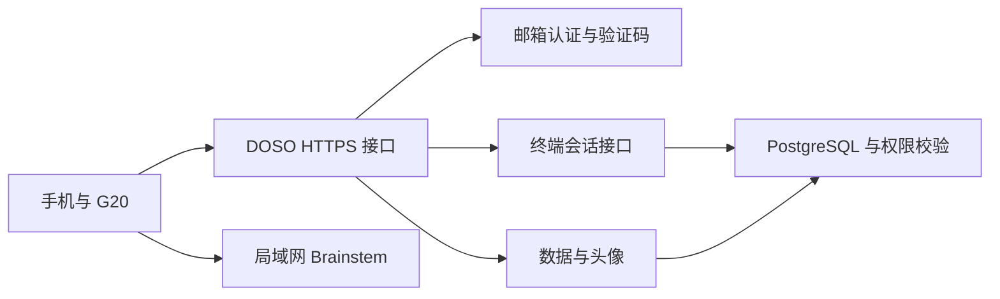

# DOSO 国内后端部署与账号迁移

## 2026-11-08 文档核对

现有阿里云业务环境已有账号、设备绑定、远程状态和视频观看授权的部署记录；云Gateway自动同步已有2026-11-04部署记录。2026-11-07使用正常Auth账号、终端登记和已登记模拟设备，跑通实际Web App到真实业务数据库的状态流程，[验证范围](D:/DOSO/robot-cloud/docs/SIMULATED_FLOW.md)含SSH隧道和模拟Brainstem，不覆盖手机注册、G20、真实机器狗或独立公网MQTT/5G。当前推进统一见 [云端进度](D:/DOSO/robot-cloud/PROGRESS.md)。本次只核对文档与现有证据，没有重新探测服务器或改变账号数据；以下按日期保留部署过程。

## 2026-11-05 产品决定：从新账号开始

森哥明确决定新环境从零开始，**不迁移旧 Supabase 的账号或业务数据**。原项目和原账号保留，未删除；用户在阿里云新环境重新注册。当前上海环境是已部署的独立测试环境，不是确认完全空库：其中此前已保留至少一个测试账号，不能为“从零”擅自删除它。正式使用前核对测试账号与真实数据边界，完成注册/验证码、登录、资料、会话登记、重启恢复及退出验收。

当日电脑以已部署的公开客户端配置进行有界只读核验：Auth health/settings 200、REST不存在表探针404/PGRST205，可信HTTPS；只证明公开服务接入，不证明真实登录或数据关系。本机通用及Android QA构建目标已指向 `https://api-test.dosorobotics.com`，EAS和已安装G20包不因此自动切换。G20实际QA code47；尚未构建或安装新包。

构建首次尝试在启动Gradle之前以环境检查失败退出：旧记录中的 `C:/toolchains/protobuf/bin/protoc.exe` 不存在；实际找到 Scoop protobuf 34.0 的编译器并确认版本，后续须使用真实路径与新证据目录。随后的单次观察可用内存低于4GiB，资源门禁止启动构建；保留首次失败结果及全部既有包和数据。登录会话在同一后端登录后原生持久保存、前后台管理续期；换后端不迁移旧token，首次需在新环境登录，具体重开与过期行为须G20验收。

第二次使用修正的编译器路径，在正常资源门测得可用内存 4,030,248 KiB，低于 4,194,304 KiB；构建启动0、输入漂移0、锁清理成功。构建守卫24项测试通过。需释放内存后再用新目录正常构建，不复用本次结果。

当日已收到完整从零使用的授权；下文历史“迁移旧账号”步骤仅作历史材料，不执行。实际运行状态以11层模型为基线，禁止重跑旧环境安装或全量数据库迁移。现阶段没有对服务器或账号数据做任何变更。

## 2026-11-04 公网 HTTPS、设备管理和远程状态 API 已实际发布

本段记录2026-11-04部署状态，下方保留更早过程，后续状态见本页顶部。该轮目标为上海 `47.103.89.137`，MQTT ECS为 `8.153.169.177`。

- `https://api-test.dosorobotics.com` 已启用可信 HTTPS。Let’s Encrypt 证书到期日为 2027-02-01，续期 timer 和 Nginx reload hook 已启用，CA 测试环境续期演练成功。原 Nginx 网站配置保留；旧官网公网仍观察到403，不宣称官网可用或备案审核已完成。
- 三份 SQL `20261103140000`、`20261103150000`、`20261103170000` 已在真实数据库事务提交，更新前已完成本次私有 `pg_dump -Fc` 和归档目录校验。备份在 `/opt/doso-backend-shadow/env/device-cloud-database-20261103-2rsbw5mz`。允许同一账号认领多台设备，保留设备唯一归属；新增各设备远程状态许可、状态保存和权限代次。
- 已实际更新 Functions 与 Envoy。有效 Compose 为原十层再追加 `doso/device-cloud-20261103/compose.device-cloud.yml`。六服务运行、六个已配置健康检查均通过，四个 core 的容器身份、启动时间、配置和挂载保持。运行时备份在 `/opt/doso-backend-shadow/env/device-cloud-20261103-_uqjjcow`。本次计数来自现场结果；下方2026-10-28无healthcheck是当时情况。
- 公网提供原 `account-sessions` 及新增 `device-binding`、`remote-state`、`remote-state-sync`。只开放明确的 Auth/REST/Functions 路由；数据库、Studio和其他未接入模块没有新增公网入口。
- Windows 使用实际公开 key 和正常 TLS 校验，Auth health/settings 均200，REST返回预期不存在探测表的PGRST205。8项真实鉴权边界通过，包括缺失/错误同步key、Bearer代替apikey、同步key访问Auth、额外函数子路径以及用户API未登录拒绝。首次绑定探测缺少action返回400，修正请求后单独验证401，没有为此改产品代码或重跑已过检查。
- RM500U-CNV协同聊天已用本机受限交接文件的合法key调用公网同步API，空设备batch返回200、`{v:1,permissions:[]}`。没有创建假设备或上传假状态。专用key仅在服务端与本机受限目录，未放入App。
- `.env.local` 的通用/Android URL及公开key已切至阿里云；Android专用Metro/QA构建入口也已从旧托管目标切换，23项直接测试通过。未构建/安装新的手机包，EAS环境尚未切换。

发布代码见 `deploy/backend/api-https-20261103/` 与 `deploy/backend/device-cloud-20261103/`。本次一次性SQL和十层升级脚本已完成，不直接重跑；以后运维必须先核对当前十一层模型。没有应用地图或全量命令子系统迁移。

实际证据：[公网服务检查](../../artifacts/remote-state-live/aliyun-public-api-after-deploy.json)、[鉴权边界最终结果](../../artifacts/remote-state-live/aliyun-api-auth-boundaries-final.json)、[发布回执](../../artifacts/remote-state-live/aliyun-device-cloud-release.json)。

仍待验收：阿里云真实用户登录与设备绑定/切换、Gateway与真实Agent发布、用户开启/关闭远程管理后的真实状态、Wi-Fi/5G和断线恢复。旧托管账号与数据没有自动迁移；URL改变后使用新域独立登录缓存。备份目前只验证归档可读，未做恢复演练。CA账号无联系邮箱，运维需关注续期失败与到期日。

## 2026-10-28 会话函数部署增量通过，当前有效模型为十层

Workbench 已从上海实例官方 Admin/22 免密入口恢复，没有重置凭据或重跑数据库迁移。实际固定镜像存在；Docker29省略默认 `Config.User`，已改为内存解析安全投影，仅缺失User沿用平台默认值，显式null/非法用户继续拒绝。保留原冻结 `--user-worker-request-idle-timeout 150000` 命令，已有部署目录只验证、不覆盖。独立复审修复保全失败误报成功和超时探测清理缺口，13项离线测试通过。

最终单次恢复工具SHA `f5c97e418227112ae69727a153b37a8bd28dd1d6a8ff1796175184f35f0f419c`，运行manifest SHA `a572eea2a35aa85d568e064a829d000308b44dd6f9c1bbd75edac2aa81b5c0aa`。无凭据依赖探测通过并清理，Functions已启动，网关仅更新两份LDS/CDS来源；20组内部HTTP通过，包括handler自身的缺失/无效Bearer拒绝。原core4、网站、冻结37文件保持。Functions没有Docker healthcheck，不能将六服务运行和HTTP验证写成六服务全部healthy。

有效Compose顺序现在是原六层 → OTP6 → compact-mail → gateway-loopback → `doso/account-sessions-20261027/compose.account-sessions.yml`（第十层）。仍只发布 `127.0.0.1:18000`，未新增公网API站点。新Functions ID `549da1a7bd585d030f952f25db35858d53f8c9030cc48515a342591df44468f6`，网关ID `9e5b3c1ae29c61fe257b1f8128d0fdf2115931c25d0afb2f502d2ca928585537`。任何后续工具先只读核对当前六服务和十层模型，不重跑旧首启、SQL或要求五服务的本次安装器。

完整回执、不可变执行源码、三次脱敏镜像诊断及实图在 `artifacts/release-readiness/20261027-domestic-api-gateway-01/`，成功回执为 `functions-install-attempt-04.json`。新公网探测仍为备案403/严格HTTPS失败，最新备案进度仍为“管局审核 / 审核中”。须在可信HTTPS完成后使用保留测试账号在本地输入凭据，验收真实JWT的登记、资料、心跳、续期和退出，再切App测试目标、构建并升级G20。当前不认定真实账号业务闭环或正式发布通过。

## 2026-10-28 会话函数部署输入和客户端回归已完成，服务器终端需恢复

在已验证的内部网关及新测试库基础上，新增 `deploy/backend/account-sessions-20261027/`：11份运行文件、7份原始源码身份、只开放精确 account-sessions 路径，保留既有Auth/REST过滤器与后台Auth/真实会话RLS校验；固定镜像，worker不接收数据库密码或JWT签名密钥。34项本地测试通过，manifest SHA `a572eea2a35aa85d568e064a829d000308b44dd6f9c1bbd75edac2aa81b5c0aa`。无凭据Deno依赖探测和带保持性检查的安装工具已准备；其本地文件准备不能算实际函数启动。

Workbench旧临时SSH连接已断开。粘贴/提交后页面仍只有旧SQL回执，未取得本次执行回执；一次正常重连仍断开，返回登录后要求服务器登录凭据，官方实例execute入口另报ERR_CONNECTION_RESET。没有把重试或静态配置冒称部署成功；已请森哥从实例远程连接重新打开普通Shell，恢复后先核对当前五服务和新目录，再继续单次依赖探测。数据库迁移不重跑。

并行客户端回归首次87项中8项失败，原结果保留：两处guestMode、五处setLogoutPending夹具缺失和一处旧loading门禁断言。仅更新两份测试夹具，保留不重复撤销/不错误兜底/不继续SDK退出断言，补忙碌状态[true,false]与门禁真值表；复跑87/87通过。App产品文件前后SHA同为 `4c8167930358e358b5078c920c8a429ef6565d5c2d7123a29e6348608d84d79e`，未改产品代码。证据在本轮目录 `client-tests/aligned-run-01.json`。

所有阶段证据位于 `artifacts/release-readiness/20261027-domestic-api-gateway-01/`，新增 `functions-submission-attempt-01.json` 说明提交与未执行确认的边界。可信公网HTTPS、备案接入、真实凭证的函数业务闭环、App切换/测试包、G20和弱网仍未验收；旧项目与账号数据保留，正式通过数不增。

## 2026-10-27 国内网关和新测试库业务结构已通过内部验收

本轮实际新增固定 Envoy 候选网关，只绑定 `127.0.0.1:18000`；启动入口/Studio依赖和私有tmpfs已适配。真实HTTP的17组检查通过：Auth/JWKS、REST OpenAPI/不存在表转发、无效密钥拒绝和未开放路径404。原四个核心容器ID/启动时间/环境/挂载、网站及冻结运行包保持；首次比较因Docker挂载顺序误报而在启动前停止，原失败回执保留，单次只读诊断后仅规范化挂载顺序，第二次实际验收成功。

森哥随后明确批准仅上海新测试库的12份SQL范围。实际保存179948bytes的root0700/0600备份、归档目录可读（尚未做完整恢复演练）；既有原生Auth会话用于事务内资料/登记/心跳/撤销及拒绝规则测试，全部回滚确认后才提交结构。SQL SHA `6bc29f269153bb79e82fe295a507e36ca4531f0d24acf57444853caf2e8d8c3f`，执行工具SHA `3bf1374d80735722622cbbb5b929ee630357f9612fb5ab930f0d4440248fa651`。结果为profiles1、terminals0、登记和heartbeat RPC存在、邮件worker关闭；Auth用户/会话可见行版本、原五服务和网站保持，旧托管项目未访问或改动。

证据 `artifacts/release-readiness/20261027-domestic-api-gateway-01/`。这些是新库SQL/RLS及内部HTTP结果，不是App真实JWT或G20验收。公网新鲜探测仍为备案403/HTTPS失败；重新登录后备案页同时出现管局审核/审核中及前序审核通过，不据此认定全部完成。`account-sessions`函数尚未接入，App目标、APK和G20没有切换，正式验收不增。后续需完成单一会话函数、可信HTTPS和实机完整链路。

## 2026-10-27 紧凑确认邮件模板已实际切换

新上海邮件模板服务已返回经验证的新版确认HTML：6208bytes，SHA `059ea02a0de00258977c2a6d04dbc9cb1171529f033ba917b383b1931a0b8115`。新字标2172×216使用独立03526版本URL，匿名严格TLS字节校验通过。仅重建mail-templates，Auth/db/rest容器ID、Auth环境、旧网站指纹、原37文件及manifest保持；无账号操作、额外邮件或公网配置变更。首次预检失败、只读诊断和成功结果分别保留在 `artifacts/release-readiness/20261027-email-compact-layout/`，最终固定回执为 `install-attempt-02.json`，源码SHA `17529899d4332bbd3f9077d4dcd379b501343f1e9e20941029599838057c72c7`。

本机当前配置必须在原六层及 `doso/compose.email-otp-six.yml` 第七层之后继续合并 `/opt/doso-backend-shadow/runtime-20261027/docker/doso/mail-layout-20261027/compose.mail-layout.yml` 第八层。该层只更换 `/app/confirmation.html` 的只读源，目录root0700、HTML0644供容器65532读取、overlay0600。旧原模板和历史MAIL_HASH/manifest不改；不重跑首启或OTP重配置工具。省略第八层会回到旧版，后续重建Auth或mail前须核对八层完整模型。需要回退时先审查当前状态，再用原七层仅重建mail-templates；本轮未回退。

本次私网HTTP正确不等于新版Auth实际发信或QQ客户端排版通过。旧托管项目未同步，App服务地址未切，国内公网/HTTPS及业务会话仍待验收；下方各时点历史保持。

2026-10-27 最新补充：本轮已从 Workbench 可见结果确认 `internal_auth_smoke_passed`，新上海私有 Auth 的注册无会话、6位邮件码确认、密码登录及同用户读取通过，新测试账号保留。脱敏固定字段保存在 `artifacts/release-readiness/20261027-email-logo-object-repair/internal-auth-smoke.json`；下文等待密码/验证码的文字属于当时历史，不再代表当前测试状态。此结果不等于 DOSO account-sessions、可信公网 HTTPS 或 App/G20 验收。

用户真实收信后报告 Logo 破损；当前运行包确认模板已引用正确的版本化 PNG，只是公开对象缺失。本轮在既有公开桶补传批准资产，匿名严格 TLS GET HTTP200、image/png、196202 bytes及完整SHA256与本地一致，同地址浏览器正常显示；旧对象、权限及模板均保留，无须重启 Auth/邮件服务。Node公开请求仍网络失败，真实QQ图片显示待确认。图片恢复不触发重发；用户另行授权的1封无验证码图片检查邮件已得到 `logo_check_smtp_accepted`，不冒称已投递。执行工具SHA `2aacff1a276cc0dc54d91e331bdbf791b622eb0145cd5e123353acf77bd32fe8`，6项离线验证通过、无重试或账号操作。最终回执见同目录 `single-mail-result-final-02.json`，首次预检停止及首次软换行结果提取空列表均单独保留。未切App或迁移旧账号数据。公网备案/HTTPS及业务会话仍是后续接入条件。

2026-10-27 19:10补充：网关自建候选已真实构建，image ID为sha256:7e5d2c0dbac760df975f4f5f809eec5f4149bfcfc0c538f2603df4ab29af25a8；平台和source labels自检通过。Docker29可选镜像字段读取已修正。单次受限版本诊断取得exit0、无OOM和已确认清理，输出官方commit及Envoy1.39.1。整体云任务仍exit1，因为旧自检错误拒绝/app/envoy前缀；原记录不改。当前本地解析器增加该固定前缀兼容，真实输出回归和共17项离线测试通过，尚未将该最新解析器安装服务器。独立assessment仅重新判读已有真实证据，不伪造新云任务成功或重跑构建。完整证据在`artifacts/release-readiness/20261027-envoy-candidate-build-01/`。

此候选不是原Envoy OCI镜像；尚未启动包装器、网关或Functions，也未发布公网端口。下一项是其配置/路由验证，以及已记录的`app-login-dependencies-readonly.md`中账号schema、account-sessions与客户端准备闭环；迁移清单仍须依目标审查，不能全量直接推入。Workbench重连后已确认旧测试进程0，负责人在当前可见终端启动一次6位验证工具、填指定邮箱，停在NEW test password；由用户本地完成密码与验证码，尚未发送注册请求。原账号/数据和App目标保留。

2026-10-27 15:44补充：新上海测试Auth邮箱OTP已实际由8位改成6位。任务t-sh071a8mt66hfcw于15:44:19—29 exit0；Auth健康，其他三个核心容器ID、实际Auth环境其余值及旧站本机指纹保持，同步安装的交互工具每次请求前要求真实OTP6。用户指定测试邮箱后，负责人已在普通Shell启动并填写，当前停在NEW test password，待用户本地无回显输入两次新密码；尚未发送注册请求。真实收信、verify、密码登录及GET /user同账号闭环仍未通过，不记录邮箱/密码/验证码。旧云账号与数据、App目标地址不变。

六位覆盖在服务器`/opt/doso-backend-shadow/runtime-20261027/docker/doso/compose.email-otp-six.yml`，必须作为原六层之后的第七层继续合并。历史`start-shadow-core.py`是不可重跑的首启工具；专用8→6工具也已完成，不重复运行。交互验收命令为`sudo -n python3 /opt/doso-backend-shadow/tools/verify-shadow-signup.py`，本次已在运行，应继续当前提示，不并发开启第二次注册或盲目重发。安装首次拒绝、只读定位、修订和实际成功证据分别保存在`artifacts/release-readiness/20261027-shadow-otp-six-01/`。

只读ICP备案订单详情已见dosorobotics.com，状态管局审核/审核中，未提交或修改备案资料。公网备案拦截、可信HTTPS、API网关、业务函数和App新环境仍未验收。以下13:37及更早记录为各时点历史，不能覆盖本段最新事实。

2026-10-27 更新。上海独立测试环境的新密钥、SMTP本地输入和核心四服务已实际完成：db/auth/rest/mail-templates健康、SMTP严格TLS认证、确认模板SHA与官网本机前后对照通过；尚未完成真实验证码收件、注册确认、密码登录及App验收。原11项服务镜像有9项已拉取，仍缺Envoy/API网关、imgproxy原镜像；同版本Envoy公开文件和自建候选另行核验，不计为原OCI通过。新域名api-test.dosorobotics.com已解析，但新鲜公网HTTP为阿里云Non-compliance ICP Filing 403，公网HTTPS/备案接入未通过，不能切换App或声称国内登录已修复。原账号与生产数据未迁移。

## 2026-10-27 实际核心服务与公网阻断

已按森哥明确授权将新环境独立密钥保存至 `/opt/doso-backend-shadow/env/.env`，实际root/0600、父目录0700；森哥在普通Shell本地输入SMTP，工具无回显。单次任务 `t-sh0719xawzzzmkg` 于13:37:18—13:37:46实际exit0，完整首尾与源码/封装身份匹配：SMTP SSL登录、四个新容器身份/健康、REST官方就绪命令、Auth health和确认模板完整SHA全部通过。仅新空数据库使用固定上游初始化，未启动网关/Studio/Storage/Functions，核心服务宿主端口0；没有读取或迁移旧云端账号、SQL/RLS或修改App地址。证据 `artifacts/release-readiness/20261027-shadow-runtime-01/core-reviewed-02/`。此工具是一次性首启门，不用于已有数据或容器的重启；失败不down/删数据，upstream unless-stopped仍可能自行重启服务。

旧站保留证据仅是本机Host=inovxio.com HTTP200、正文及Nginx配置前后SHA相同。新鲜电脑公网匿名对照显示新域名及该IP的inovxio.com Host均为403、Server=Beaver、title=Non-compliance ICP Filing。不能由本机200冒称公网旧站可用，也不能据此断言具体属于未备案、未接入、核查不合格或同步延迟，需在备案控制台核对。阿里云[备案阻断排查](https://help.aliyun.com/zh/icp-filing/basic-icp-service/web-site-for-the-record-to-block-1)及[接入备案FAQ](https://help.aliyun.com/zh/icp-filing/basic-icp-service/support/access-for-the-record-the-faq/)说明该层可阻断80/443和接口。按正式备案/接入流程处理，不换端口或关闭证书验证绕过；也不将新域名403倒推为旧Supabase TLS reset的原因。

真实注册测试将在用户本地输入的新测试邮箱/密码/8位验证码上进行，仅访问已核对的新Auth容器私有网络，保留测试账号；这不代替公网HTTPS、DOSO业务会话函数和手机/G20客户端验收。SMTP认证成功不等于验证码投递。已进入聊天的SMTP凭据须由所有者后续轮换并同步相关配置，工具不从聊天复制密码，也不擅自修改旧项目SMTP。

## 最新实际执行：运行环境、镜像与 DNS

最终 `DOSO-docker-bootstrap-20261026-05` 真实完成 exit 0：Docker `29.1.3`、Compose `2.40.3+ds1-0ubuntu1~22.04.1`，容器数 0、无 Docker TCP 监听。官网前后 HTTP200、页面内容哈希及 Nginx 配置哈希一致；旧站、原账号和数据保留。Docker 按正常方式建立自身 bridge/NAT 内部网络，没有手工清空旧规则、修改云防火墙或给用户追加 docker 组权限。

`deploy/backend/bootstrap-host.sh` 仅用于这台 Ubuntu22.04/amd64 已核验环境的首次安装，已有 Docker/容器环境会停止，不作为通用覆盖升级器。它先验证实际系统/资源/并发/网络规则，再模拟并限定官方 Ubuntu 新依赖，禁止移除、升级旧应用或放宽鉴权。最终源码 SHA256 为 `72625b3625157ba351cd8b4d1f5a962e3b361b48b6e8d7aab08ce3a655388b94`；测试及独立复核已通过。原始 apt/服务细节留在服务器 root-only 日志，本地仅保存脱敏状态；不要为重复核验而再次执行安装。

前四次均未进入 apt，分别定位并修正标准系统链接、默认 UFW、真实 type129 与 xt:null 序列化兼容问题。历史结果独立保留，最新成功证据在 `artifacts/release-readiness/20261026-aliyun-backend-deployment-attempt05/`。完整结果与脚本身份见 `bootstrap-install-result.json`。

Auth 的真实镜像层拉取已成功；剩余10项批次`t-sh0717vj6phq41s`于2026-10-26 23:50:20至次日00:10:08实际执行，exit1，Studio、Storage、DB三项成功，均核对固定RepoDigest/镜像ID/`linux/amd64`。Google缓存的Envoy、PostgREST为network_timeout；Realtime、imgproxy、Meta、Functions、Supavisor为单项180秒pull_timeout。合计4/11项就绪，不重跑整批，不把manifest对照当镜像层成功。完整结果为`pull-remaining-result.json`、`pull-remaining-final-output.txt`及`pull-remaining-final.png`；Auth证据`pull-auth-result.json`保持。随后PostgREST的官方ECR任务t-sh0717zasmemuio实际exit0；最后Meta/Functions/Supavisor任务t-sh07180mu21awhs于00:47:31—00:50:08完成exit0，四项均与原固定digest及amd64平台一致。累计8/11项就绪，当前仍缺Envoy/API网关、Realtime、imgproxy。新结果及实图分别在20261027-ecr-rest-probe/和20261027-ecr-followup/，DOM渲染结果不冒称原始stdout字节。电脑端Envoy离线导出失败，无可上传归档。

`api-test.dosorobotics.com` 的 A 记录已于 2026-10-26 23:43:10（UTC+8）实际提交，指向 `47.103.89.137`，TTL 600 秒。提交证据为同目录 `dns-api-test-committed.json`、`dns-api-test-committed.png`；随后本机系统 DNS 与权威 `dns21.hichina.com` 均返回该地址和 TTL 600。先前确认预览的成功声明已被 `dns-verification-correction.json` 撤销，不作为提交证据。解析一致不代表全球传播、可信证书或 HTTPS 已验收。当前下一步是完成固定镜像获取、密钥安全生成适配和 HTTPS，再启动空的隔离测试后端，不切换生产账号。

之后单次任务 `t-sh07183acii1gjk` 于 01:17:16—01:17:25 完成，整体 exit1：Realtime 的官方 ECR 固定 digest、RepoDigest、linux/amd64 实际通过；imgproxy 的 ECR 候选返回 registry_denied。累计为9/11，不重跑旧批次。证据在 `artifacts/release-readiness/20261027-ecr-remaining-two/`，包含完整首尾标记的规范化可见 DOM JSON，未冒称原始 stdout。Envoy 同版本官方 release 二进制已在电脑核对大小、SHA256、ELF/amd64，仍不是原 OCI 镜像，也未执行；服务器获取任务独立记录在 `20261027-envoy-server-asset/`，不计入镜像通过数。

服务器取得Envoy文件的单次任务 `t-sh0719mbys54tmo` 于11:34:19—11:37:20实际exit1，完整输出为 `asset_download_or_identity_failed`，未证明服务器有可用文件；不根据约181秒耗时猜测具体网络或校验阶段。未再提交同一路径，也未执行binary。新环境工具经Node2/2、Python11/11和独立源码复审通过，但真实新密钥落盘仍待明确路径范围确认，SMTP仍待本地安全配置。后续先取最小内部链路的实际健康证据，再做网关/HTTPS/Functions；不因缺图片处理服务拖住不依赖它的内部验证。

## 当前部署目标：复用已存在的上海服务器

森哥要求先查看已有资源。已通过已登录控制台找到 `Ubuntu-imon`，完成云命令助手两次执行并读取完整结果。以下保留初次只读预检事实，安装与下载状态以本页顶部的最新执行记录为准；此前检查过程保留在下一节。

| 项目 | 本轮实际结果 |
| --- | --- |
| 地域与购买规格 | 华东2（上海），2 vCPU、4 GiB、50 GiB ESSD；运行中，到期 2027-03-11 |
| 系统 | Ubuntu 22.04.5 LTS，x86_64 |
| 主机可见资源 | 总内存约 3.41 GiB，可用约 2.80 GiB，无 swap；根分区可用约 42.23 GiB |
| 现有服务 | Nginx 正在监听 80；站点为 `inovxio.com`、`www.inovxio.com`，本机 HTTP 返回 200 |
| 容器条件 | 初检时 Docker 未安装；现已首装通过，尚未启动 Supabase 容器。初检未见 443/18000 监听，不等于公网防火墙已放行 |
| 镜像下载路径 | 初检 Docker 下载站 HTTP 200、Hub registry 超时；现已实际拉取9/11项，镜像批次均已结束，仍缺Envoy/imgproxy原镜像；官方Envoy release文件另作候选验证 |
| 原云项目对照 | 服务器匿名访问原 Auth 与 `account-sessions` 均收到 HTTP 401，TLS 证书校验正常；只证明该路径可达 |

这台主机可作为小规模独立测试候选，不能凭规格判定生产负载合格。保留旧站，使用已有 Nginx 新增单独 API HTTPS 站点；不重装系统，不替换官网，不新购资源。实例 ID、IP、命令执行 ID 与截图保存在被 Git 忽略的本地证据目录，不纳入公开部署模板。

实际云命令为 `DOSO-readonly-preflight-20261026-01` 和 `DOSO-readonly-route-20261026-02`，均 exit 0，起止标记完整。只读取资源、监听、工具、服务名和站点公开指令，并发送匿名有界网络探测；没有读取环境变量、密钥、完整业务配置或账号数据库。创建了两条云命令执行记录，未修改主机应用配置、账号数据、DNS、防火墙或密码。SSH 公钥登录未成功，未重置密码或跳过主机校验；后续使用已存在的云命令助手。

证据：`artifacts/release-readiness/20261026-aliyun-server-inventory/`。当前下一步是解决受控镜像获取、确认测试域名和可信 HTTPS，再部署空的隔离测试后端；真实账号迁移和 App 切换仍在后续验收门内。服务器能访问原项目不表示数据已迁回国内，也不把国内转发代理算作迁移完成。

## 较早检查记录：阿里云登录后推进

森哥已明确要求使用中国内地资源并开始迁移。优先核对阿里云 RDS Supabase 托管，拟选华东2（上海）；这是目标方案，不是已创建实例。`self-hosted/v0.8.3` 只表示前一轮准备的官方 Docker 配置发布号，既不是 DOSO App 版本，也不是地域。采用阿里云托管时不需要安装这个自托管包。

新查到的官方能力比最初概览更明确：[Deno 边缘函数及 Secret](https://help.aliyun.com/zh/rds/apsaradb-rds-for-postgresql/using-sandboxes-and-edge-functions)、[SMTP、OTP 长度/有效期和模板](https://help.aliyun.com/zh/rds/apsaradb-rds-for-postgresql/configure-email-authentication-and-templates-for-rds-supabase)、[Cloud→RDS 迁移工具](https://help.aliyun.com/zh/rds/apsaradb-rds-for-postgresql/supabase-migration-tool)均有专门文档。函数当前公测且限北京、上海、杭州、深圳、成都，实例资格与费用仍以账号控制台为准；不能由文档推断本账号已经开通。

已从已登录控制台看到上海轻量服务器相关资源类别，尚未读取实例规格、现有业务占用或 RDS 实例列表，不能据此决定复用或称没有服务器。侧边栏读取两次超时，已有 Edge 页读取一次超时；改用用户偏好的 Windows Advanced 后可读取首页，但桌面输入发生焦点切换，最终因前台微信被工具拒绝，已暂停输入，未绕过窗口校验。没有确认 RDS 目标、填写或提交资源订单、授权角色、访问规则、迁移或费用。

官方迁移 v1.2 源码已下载到新证据目录，仅做静态审查，不运行下载代码。初步确认原样执行不适合 DOSO：默认 schema 只含 `public`，缺少 `private`；数据库 dump/restore 使用 `--no-acl` / `--no-owner`，不能据此保留现有 grants；Cloud 示例默认不迁 Auth。完整审查记录位于 `artifacts/release-readiness/20261026-aliyun-rds-migration/official-tool/`。不得把工具成功退出当作用户、权限、会话及设备归属都正确的证明。

进一步审查确认网页与下载包有差异：网页 Cloud 示例 `auth.enabled=false`，下载包配置与模型却默认四条管道全部开启。源码的 dry-run 校验失败及部分对象失败也可能返回成功；CLI 函数分支引用源 Cloud 项目；日志/子进程参数和 multipart 路径没有达到 DOSO 的凭据及路径处理要求。默认 WebUI 对外监听且无认证。**不运行原样工具、WebUI、validate 或 dry-run，不以补几处开关代替整体迁移审查。** 保留原源码与哈希，后续在明确目标上按受审的 Auth→业务 schema/权限→对象/metadata→Functions 分阶段演练；原 UUID 和私有头像权限必须单独核对。

App runtime 的 URL/key 当前可传给标准 SDK，但正常 QA 出包链仍固定原项目 URL 和 `sb_publishable_` 格式。确认新 HTTPS origin 与公开 Anon Key 后，需要在正常构建配置中做明确目标的适配；不能直接替换 `.env` 或跳过构建门。当前 App/构建脚本及线上地址均未改动。

## 选择与依据

保留现有 Supabase 技术栈，先建立独立测试后端。现有登录链是 `Auth → account-sessions → profiles → App`，需要一起接通；只换 PostgreSQL 不够。旧项目的匿名请求在 TLS 握手收到 HTTP 前失败，不能据此断定某台路由器或运营商是重置发送者。

| 路径 | 官方现状 | DOSO 判断 |
| --- | --- | --- |
| 国内 Linux 服务器运行官方 Docker 栈 | Supabase 官方支持自托管 Auth、API、数据库、Storage、Realtime 和 Functions | 已准备可核验配置。已有合适服务器时可直接进入部署核对；服务器运维、备份、升级由我们负责 |
| 阿里云 RDS Supabase | 官方提供托管 Auth、Data API、Storage、Realtime，并有 Deno 函数、邮件配置和迁移专门文档；创建项目涉及资源和费用 | 当前优先核对。DOSO 自定义会话函数、`auth.sessions` 权限、实际邮件与动态公网客户端仍需新实例实测 |
| 华为云官方部署方案 | 官方资源栈在云服务器上部署 Docker Compose | 可用的安装路径，仍需我们验收 DOSO 配置；不是已经核验的 DOSO 托管服务，不按模板直接购买 |

来源：[Supabase Docker](https://supabase.com/docs/guides/self-hosting/docker)、[阿里云 RDS Supabase](https://help.aliyun.com/zh/rds/apsaradb-rds-for-postgresql/supabase/)、[华为云部署说明](https://support.huaweicloud.com/supabase/supabase_05.html)。不依据第三方博客的“一键成功”判断兼容。

阿里云项目的管理后台 IP 白名单、App 公网 API 准入和数据库访问范围需分别核实；手机与 G20 的出口 IP 会变化，不能把数据库向全网开放当作移动客户端接入方案。阿里云文档中的创建、SLR 授权及购买步骤本轮均未执行，试用资格和实际价格未核验。

## 用户实际看到的链路



云端处理账号和归属；局域网处理机器人连接。当前 QA 包的免登录设备测试不制造云账号，也不能代替注册、登录验收。

## 已准备的自托管材料

- `deploy/backend/upstream.lock.json`：官方稳定发布 `self-hosted/v0.8.3`，commit `bc27d2661edd09a5d0b8d76ce33da6d4071a756e`；28 个必要文件共 300894 bytes，包含原许可证。不是跟随 master 的滚动下载。
- `deploy/backend/prepare.mjs`：默认只显示计划；指定全新输出目录才下载。拒绝覆盖、越界、真实 `.env`、符号链接和重定向，校验字节数、Git blob SHA1 与 SHA256；失败不发布完整清单。
- `deploy/backend/compose.doso.yml`、`Caddyfile`：合并官方配置，移除 API 网关及数据库连接池宿主端口，用于全新主机的 Caddy HTTPS 路径；管理后台、MCP、默认 hello 函数不经公网代理。
- `deploy/backend/compose.host-nginx.yml`、`nginx.doso.conf.example`：已存在 Nginx 的上海主机追加第四层，只向宿主 loopback 发布 18000；Caddy 默认不启动，显式启用其 profile 也不发布端口。Nginx 模板保留旧站，限定 API 路径，支持 WebSocket，并使用不含 URL、查询参数、请求头或正文的独立状态日志。
- Auth 保持邮箱确认，密码至少 10 位且含大小写及数字；邮箱 OTP 为 8 位、600 秒、重发间隔 60 秒。未降低原有身份和权限校验。
- Caddy 镜像已固定版本及 digest，但此主机不启用。11 项基础服务另有受审的 amd64 镜像第五层，固定 GHCR、Supabase官方ECR或Google缓存的manifest digest，均已与原官方版本对照；9/11项镜像层已拉取，余两项未通过。manifest digest 与镜像配置 ID 分别核对，不把前者当作所有镜像层已下载。

本地准备命令，不启动服务、不生成密钥：

```sh
node deploy/backend/prepare.mjs
node --test deploy/backend/prepare.test.mjs
node deploy/backend/prepare.mjs --output /absolute/path/to/new-doso-backend
```

本机 Node 直连官方 raw 文件失败一次，旧失败目录保留。Windows HTTPS 正常下载了同一 commit 的官方文件；随后通过同一准备函数从这些缓存字节完成三重校验。不能称 Node 网络 CLI 已成功下载。较早两模板包保留在 `artifacts/release-readiness/20261026-selfhost-backend/candidate-02/`；当前四模板候选在 `artifacts/release-readiness/20261026-aliyun-server-inventory/host-overlay-validation/reviewed/candidate/`，不覆盖历史包或旧哈希。

## 部署前仍需确认的条件

1. 目标已选为上述现有上海服务器，Docker/Compose 已首装通过，尚未启动 Supabase 栈。官方最低 2 核、4 GB、40 GB SSD；推荐 4 核以上、8 GB 以上、80 GB SSD 以上。当前仅符合测试候选规格，启动后还需检查内存、OOM 与官网影响。本机 Windows Docker 引擎未运行，没有把开发电脑当成公网后台。
2. 测试 API 域名 `api-test.dosorobotics.com` 的 A 记录已实际提交并通过两路 DNS 对照，可信 HTTPS 证书与新站点仍未配置验证；正式 `api.dosorobotics.com` 未切换。现有 `auth.dosorobotics.com` 是邮件发信域，不改用途。
3. 服务器 DNS、80/443 与仅管理员可达的维护入口。数据库和管理后台不向 App 用户开放。官方容器名是固定值，不能只改 Compose 项目名便假定与现有实例隔离。
4. 确认目标域名和 App 的备案/接入条件。仓库中的域名订单记录是历史材料，不证明今天已经完成；App 备案与网站备案不同。参照[阿里云 App 备案 FAQ](https://help.aliyun.com/zh/icp-filing/basic-icp-service/support/basics-about-icp-filling-for-apps)。

域名和证书配置遵循[官方 HTTPS 说明](https://supabase.com/docs/guides/self-hosting/self-hosted-proxy-https)。不关闭证书校验，不用 HTTP 承载公网密码和令牌，不假定换地域就自动解决原网络故障。

## 在隔离测试环境中配置

以下为后续执行步骤，不是本轮执行记录。复用现有上海主机，先核对配置范围和回退位置，再处理隔离测试环境；不把真实密码或密钥发到聊天或存进仓库。

在生成目录的 `docker/` 内建立受保护的新服务器 `.env`，使用新环境独立密钥，不复用示例值或原项目 service key。**不要原样执行**所锁定的 `utils/generate-keys.sh`、`utils/add-new-auth-keys.sh`：源码包含 `-hmac` 和 Node argv 传递秘密，凭据可能进入进程命令行；仅将 stdout 重定向到 `/dev/null` 不能解决。

安全适配源码已实现为 `deploy/backend/prepare-shadow-env.py` 与 `generate-shadow-keys.mjs`。它只接受固定官方 `.env.example` 身份及已批准的测试 origin；目标必须是 root 所有的0700空目录，独占创建0600 `.env` 并 fsync，禁止覆盖旧环境。固定已下载 Meta 镜像里的 Node 以无网络、无容器日志、只读文件系统运行；秘密只经过私有 pipe，不进入 argv、聊天或输出。JWT/JWK、opaque key和随机字段格式通过校验；Node真实验证其生成的ES256签名，Python再次检查HS256签名及ES256结构，不能称Python做了ES256验签。超时只凭本次私有cidfile中的严格CID清理，清理失败明确报告未确认。Node2项及Python11项离线测试通过，均仅用内存临时测试值；工具尚未在服务器生成真实密钥或环境文件。依照本聊天的凭据保存边界，实际生成前仍需森哥明确确认新测试env的路径和保护范围。

工具输出 `pending_smtp`、`can_start=false`：已去掉全部SMTP示例值及示例OpenAI key，不伪造邮件设置、不自动确认邮箱。必须安全配置已开通的DirectMail后，才允许运行强制DOSO覆盖层；未配置时应失败。原账号、旧项目密钥及数据不会被该工具读取或迁移。

| 配置 | 要求 |
| --- | --- |
| `PROXY_DOMAIN` | 已批准且解析到新服务器的 API 主机名，不含协议、路径或账号 |
| `SUPABASE_PUBLIC_URL` | 新 API 的 `https://...` origin |
| `API_EXTERNAL_URL` | 同一 origin 后接 `/auth/v1` |
| `SITE_URL` | 与仓库现有 Auth 配置一致的 `doso://auth/callback`；不是数据库域名或未确认的网站 |
| `ADDITIONAL_REDIRECT_URLS` | 精确核对 App 已用的 `doso://auth/callback`、`doso://auth/reset-password`、`https://links.dosorobotics.com/auth/callback` 和 `/auth/reset-password`，不扩成通配符 |
| `DOSO_ALLOWED_WEB_ORIGINS` | 只填实际 Web 与管理端 origin；默认空会拒绝 Web，原生请求仍须正常鉴权 |
| SMTP | 已有 DirectMail 服务与历史 SMTP 接受证据，见 [邮件记录](../DOSO_EMAIL_DOMAIN.md)，不另购服务；新服务器尚未配置，须复核现有服务状态并安全配置后做受控收件测试，不把历史 `250` 当作本轮投递通过 |
| `JWT_KEYS` / `JWT_JWKS` 与其他密钥 | 新环境安全生成并保管。`JWT_JWKS` 若含 `kty=oct` 的 `k`，该值是对称秘密，只留服务端内部，不发送到 App、公网 JWKS、日志或公开归档；App 只取公开 URL/publishable key |

当前上海主机必须同时指定以下五份文件，保留现有 Nginx；不设置 `manual-caddy` profile。第五层的实际来源是 `artifacts/release-readiness/20261027-ecr-remaining-two/compose.images-amd64.yml`。准备工具仍只复制四个模板；第五层须单独受控传入同一生成目录的 `docker/doso/compose.images-amd64.yml` 并核对源文件身份，不能假定已经在服务器落盘。每次 `config` 和后续服务操作都使用完整五层，避免回到官方 Hub tag 或公开默认端口。全新且没有 Web 服务的主机另行核对 Caddy 路径，不套用本机的首装假设：

```sh
docker compose --env-file .env \
  -f docker-compose.yml \
  -f docker-compose.caddy.yml \
  -f doso/compose.doso.yml \
  -f doso/compose.host-nginx.yml \
  -f doso/compose.images-amd64.yml config --quiet
```

需要支持 `!reset`、`!override` 的 Compose（至少 2.24.4）；本机以 5.1.0 的真实合并解析通过，上海主机现装版本为 2.40.3。不要输出完整生产 `config`，里面会展开密钥。

不必等待11项完整镜像就绪才做最小内部验证：在安全env和真实SMTP完成后，可以使用同一完整五层，指定 `up -d --wait --pull never db auth rest`，仅启动这三项已有依赖，检查数据库、Auth健康和REST就绪；三项不发布宿主端口。Functions依赖网关健康，不能靠删除依赖绕过，也不能把三项内部健康当作DOSO登录成功。完整服务启动仍须全部固定镜像、安全env及下述接入条件通过，明确禁止自动拉取；缺镜像应直接失败，不回源Hub或临时换tag。以下是后续完整启动命令，本轮尚未启动容器：

```sh
docker compose --env-file .env \
  -f docker-compose.yml \
  -f docker-compose.caddy.yml \
  -f doso/compose.doso.yml \
  -f doso/compose.host-nginx.yml \
  -f doso/compose.images-amd64.yml up -d --pull never
```

上海主机只新增独立 Nginx 站点：替换模板里的保留域名和证书占位路径，使用最终测试域名的可信证书；保留现有默认站点和日志。先执行真实 `nginx -t`，成功后才平滑 reload，并核对官网前后 HTTP 与资源占用。原始错误日志可能包含验证码回调 URL，因此新站仅保留脱敏方法、状态和耗时；补充结构化错误诊断前必须验证脱敏。该语法、证书、转发与旧站对照尚未在服务器执行。

镜像获取不能依赖不明加速站。此前11项基础服务默认使用Docker Hub，原配置锁不是镜像层下载证明；旧第五层固定9项GHCR与2项Google缓存。当前覆盖保留11个原digest，将REST/Meta/Functions/Supavisor/Realtime改为官方ECR，为5项GHCR、5项ECR和1项Google缓存；imgproxy仍使用原GHCR固定来源，不把失败的ECR候选写入当前覆盖。新覆盖SHA256为9fec244596d9a6da27de1c12961e5fdba853da0e808f1f34ca4db2a096e929e8，真实五层Compose合并通过11默认服务及唯一loopback端口，证据image-overlay-validation.json。逐项官方原版本对照证据在 attempt01 的 `registry-source-comparison.json`、`google-cache-manifest-comparison.json` 和 `envoy-official-manifest.json`；Google域名本身不构成vendor身份依据。上海实际层拉取以本页顶部的逐项结果为准，旧失败保留；当前剩两项原镜像未就绪，不重跑旧批次。阿里云[官方镜像加速限制](https://help.aliyun.com/zh/acr/user-guide/accelerate-the-pulls-of-docker-official-images)说明不能保证新版本，不能据此改用滚动tag。未开通付费仓库。`docker save`归档哈希、镜像配置digest、registry manifest digest互不替代；详细历史来源见 `mirror-source-review.md`。

## 让 DOSO 真正能登录的必需步骤

1. **先核实线上 schema 基线。** 记录版本、扩展、RLS、函数、grants、触发器及 Auth Session 语义。仓库候选 SQL 不等于当前云端结构；仍遵守 [现有部署门](../NETWORK_BACKEND.md)，不直接全量 `db push`。
2. **部署匹配的会话接口。** 审核 `account-sessions` 与 `_shared` 的依赖及数据库 RPC 后复制到新 Functions runtime，配置新服务自己的 URL/key。自托管[函数部署方式](https://supabase.com/docs/guides/self-hosting/self-hosted-functions)不同于托管 CLI。当前包没有自动复制 DOSO 函数或执行 SQL；本轮 Caddy 只开放该会话函数路径，其余业务函数逐项审查后加入。
3. **接入现有验证码模板。** 审核并挂接 `supabase/templates/confirmation.html`、`recovery.html` 及实际启用的其他模板，确保 `{{ .Token }}` 仍存在。默认模板不等于 DOSO 验证码邮件。模板 Logo 当前仍引用旧项目 Storage，须在新可达位置提供同一对象再受控替换，不把旧域名依赖带入新链路。
4. **隔离邮件 worker。** 新测试环境不启动生产安全邮件 outbox 投递，不导入旧待发队列后自动重发。
5. **先用受控测试账号跑完整流程。** 不先导入真实账号，不切换原 APK 配置，不删除现有账户或重置密码。

## 分阶段验收与账号保留

| 阶段 | 必需证据 | 当前 |
| --- | --- | --- |
| 准备 | 固定源码、完整性测试、合并端口/邮件策略配置 | 当前四模板测试 20/20、Compose 18 项断言及独立复核通过；仅本地准备 |
| 主机预检 | 当前资源、旧站占用、下载与原云链路 | Docker/Compose真实首装通过，官网前后不变；9/11项镜像层已实际核验，镜像批次均结束，余两项原镜像未就绪 |
| 网络 | 新域名有效证书；G20、电脑、手机在原 Wi-Fi 与独立热点对照，Auth 与会话地址收到预期 HTTP | 测试域名 A 已提交，系统/权威解析一致；可信 HTTPS 及 App 端到端未执行 |
| 测试账户 | 注册→收到 8 位码→验证→登录→终端登记→profiles→重启恢复；错误码、过期、撤销与账号隔离 | 未执行 |
| 数据迁移演练 | 原 UUID/密码哈希/邮箱确认/身份/MFA 与设备归属、终端和权限关系；头像 metadata 与实际字节一致 | 未执行 |
| 切换 | 备份可恢复、写入切换窗口、单一邮件 worker、App 新 URL/key/callback、重新登录与回退步骤 | 未批准、未执行 |

匿名连通可复用 `scripts/check-backend-connectivity.mjs`；它只证明基础 HTTP 服务可达，不证明账户或注册成功。新端点先通过此检查，再在 G20 做真实账号流程。

[官方迁移指南](https://supabase.com/docs/guides/self-hosting/restore-from-platform)说明 Auth 用户可随受支持的导出保留，但新密钥使原 token 失效，需要重新登录；Storage 对象文件和 Edge Functions 需要另行转移。更换域名还会改变当前 App 的 Session 存储命名空间，不能伪造或复制旧 token 来假装会话恢复成功。

保留原项目作为回退点；在新服务完整验收、账号迁移授权范围和数据核对通过前，不让旧、新两个后台同时承接真实用户写入。不能用重新注册全部用户来代替迁移。

## 本轮证据与下一步

较早全新主机材料在 `artifacts/release-readiness/20261026-selfhost-backend/`，17 项历史测试及 12 服务 Caddy 解析记录保持不变。当前上海主机证据在 `artifacts/release-readiness/20261026-aliyun-server-inventory/`，四模板候选的 20 项测试、18 项 Compose 断言及独立 `APPROVE_SCOPE` 通过；默认 11 服务，仅 API 网关发布 `127.0.0.1:18000`。不把本地检查计为容器或账号正式通过数。

本轮可复现配置归档为 `DOSO-backend-shanghai-config-v1.zip`，80491 bytes，SHA256 `54c8fdcae2adcd2d4b196f41326fcf6826f0ac272b2bb725c5807aa55b22ca60`；33 项包含 28 官方文件、4 模板及清单，归档解读字节与候选逐项一致。归档没有生产凭据或容器镜像，仍含明确的域名/证书占位；不是已运行后端或 App 安装包。身份记录为同目录 `deployment-config-archive.json`。

已有服务器、Docker/Compose、部分镜像层和测试 DNS 已有真实证据，不需要先购买另一台服务器或新的邮件服务。下一步完成镜像批次、安全密钥生成适配、可信 HTTPS 和既有 DirectMail 在新服务器的安全配置，再搭建空的隔离测试后端、接通匹配的 SQL/Functions/邮件并验证测试账号。Supabase 容器尚未启动，未生成新环境凭据、读取或迁移生产数据；原账号和旧项目保留。不要在新链路未接通前反复让 G20 重试原域名。
