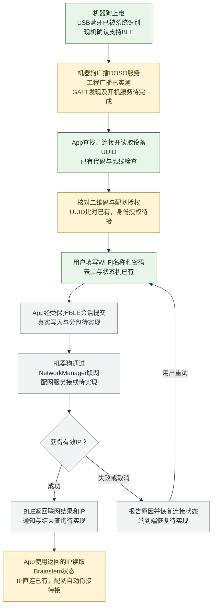

# 机器狗端BLE配网怎么实现

## 2026-11-11 完成情况

**当前已完成机器狗真实广播与电脑扫描，协议抓包已出现DOSO服务发现响应；客户端连接仍超时，设备UUID读取与完整BLE配网仍待完成。App与机器狗之间的Wi-Fi提交和结果通道尚待接通。**

### 独立推进的两项缺口

| 范围 | 当前缺口 | 推进方式 |
| --- | --- | --- |
| BLE传输 | GATT连接不稳定、服务发现缓慢，设备编号未成功读出；凭据写入与结果通知仍待实现 | 保留现有证据，进行可回退的驱动或独立客户端对照，随后验收真实读写及通知 |
| 机器狗联网执行 | 广播/设备编号原型尚未提供完整的Wi-Fi提交、NetworkManager激活与结果回传 | 先通过现有SSH或有线管理连接开发和测试联网执行，再接入BLE传输与App页面 |

局域网IP直连控制可以独立继续验收。现有连接默认地址为192.168.66.64，控制走现有Brainstem链路。2026-11-12森哥确认采用机器狗自身AP作为默认本地连接方式，热点侧规划固定地址192.168.50.1:13145。配置与验收要求见[网络方案](../runbooks/DOSO_ROBOT_NETWORK_PRODUCTION.md)，阶段安排见[功能需求与交付待办](DOSO_FUNCTIONAL_REQUIREMENTS_AND_DELIVERY_BACKLOG.md#当前推进顺序)。当前文档调整尚未新增联网执行接口或部署SoftAP。

### 00:54后续连接已开始ATT交互

进一步有界探针窗口内，后续连接的Windows端于00:54:50收到远端版本完成事件，随后发出MTU请求。整段记录已有ATT双向各33包，并于00:56:17收到包含DOSO服务UUID的服务发现响应。但客户端已超时，Windows协议栈仍在继续发现，尚未观察到DOSO设备UUID特征读取成功。末段相邻ATT接收约每4.38秒出现，当前仍达不到可用配网连接。探针早期连接失败，后续连接才出现这些结果，无法把改善直接归因于单次版本查询。[首轮目标时间线](../../artifacts/ble-provisioning/20261110-real-connection/windows-stack/target-timeline-version-probe-first.json)

两轮真实客户端测试分别耗时约18.94秒及64.06秒，均在连接阶段以TimeoutError结束。第二轮设置60秒连接等待，初始连接出现`0x3e`，后续ATT交互不能直接归因于初始连接的版本查询。最终关闭反向服务探索的对照中，电脑探针未在机器狗有界观察/广播窗口内完成，观察器没有捕获连接，该轮已中止，不能判为90秒协议超时或设置有效。[首轮客户端](../../artifacts/ble-provisioning/20261110-real-connection/windows-version-probe.json)、[60秒等待复测](../../artifacts/ble-provisioning/20261110-real-connection/windows-version-long.json)与[无有效结果的隔离对照](../../artifacts/ble-provisioning/20261110-real-connection/windows-reverse-isolation.json)

本轮已按测试前快照恢复BlueZ配置，保留已经验收的广播间隔160/240，恢复反向服务探索默认值。测试广播与诊断已停止，最终活动广播0，BlueZ、NetworkManager与Brainstem均active。后续测试需要显式启动广播。设备UUID和Wi-Fi凭据均未写入，具体根因仍未唯一确认。[恢复与清理](../../artifacts/ble-provisioning/20261110-real-connection/robot-version-final-cleanup.json)

### 两端同期抓包的最新结论

2026-11-10 23:52的同期记录确认机器狗与Windows已经建链，电脑发出SMP配对请求，并实际收到机器狗的SMP配对响应及ATT MTU请求。Windows随后没有发出ATT响应或GATT服务发现请求，约33秒后由本地请求断开。设备UUID读取尚未开始。首份同期Windows ETL报告丢失事件0。[目标时间线](../../artifacts/ble-provisioning/20261110-real-connection/windows-stack/target-timeline.json)与[采集覆盖记录](../../artifacts/ble-provisioning/20261110-real-connection/windows-stack/capture-coverage.json)

同期机器狗内核函数跟踪中，三次相关ACL发送到USB完成回调约83～112微秒；读取的HCI收发错误计数均为0。当前证据未显示机器狗主机发送排队数秒。USB完成回调与HCI统计的验证范围止于主机传输路径，空口及Windows后续处理仍需定位。两端时钟偏差约3.819秒，校正后MTU请求和SMP响应到Windows HCI记录约延迟3.48秒。[USB函数跟踪](../../artifacts/ble-provisioning/20261110-real-connection/usb-function-synchronized.txt)、[错误计数](../../artifacts/ble-provisioning/20261110-real-connection/robot-usb-completion-counter.json)与[两端证据说明](../../artifacts/ble-provisioning/20261110-real-connection/README.md)

2026-11-11 00:23重新开关Windows蓝牙后，控制器接受的Event Mask中bit 11已开启。该轮目标建链成功，远端版本查询被接受，采集范围内仍未见版本完成事件；GATT复测仍Unreachable。这条线索尚未确定根因。首份长时配对采集没有初始化掩码，重置后的短时采集只覆盖建链后约2秒，不能合并宣称同一连接已在确认掩码后等待完整超时。WPR停止后的合并完成时间也不代表持续采集到该时刻。[重置与复测](../../artifacts/ble-provisioning/20261110-real-connection/windows-after-radio-reset.json)与[掩码时间线](../../artifacts/ble-provisioning/20261110-real-connection/windows-stack/target-timeline-radio-reset.json)

下一步在核对硬件ID与回退条件后进行Windows驱动版本A/B，或使用独立客户端/控制器交叉对照，重复同一服务发现和UUID读取流程。具体驱动、控制器及空口归因尚待确认。当前机器狗为Actions ATS2851 USB `10d7:b012`，Windows为MediaTek `0489:e11e`、驱动`1.1045.0.566`。当前客户端仅有电脑，G20/手机和备用适配器交叉验收仍待安排。完整BLE配网还需完成永久身份核对、授权、受保护Wi-Fi写入、NetworkManager激活及结果通知。

下方22:58及更早记录保留各自测试时点，限时广播的启动记录不代表机器狗现在持续可发现。

### 22:58 广播发现优化与连接排查

本轮已修正现机广播间隔。通过BlueZ 5.64的系统参数，将实际HCI广播间隔从1280 ms改为100～150 ms，已保存到 `/etc/bluetooth/main.conf` 并通过蓝牙服务重载复验。原配置备份为 `/var/backups/doso-bluez-main-20261110.conf`。

同一台Windows电脑、同一目标地址，使用App对应的8秒扫描窗口各测3次。原配置发现2次，耗时5.08与5.95秒，另1次超时；新配置3次均发现，耗时1.60、0.06与1.07秒。这组小样本说明本轮发现速度改善，其他手机与G20仍待验收。[原配置扫描](../../artifacts/ble-provisioning/20261110-real-connection/scans-baseline.json)与[新配置扫描](../../artifacts/ble-provisioning/20261110-real-connection/scans-fast.json)

当前继续保留限时只读工程广播，名称 `DOSO`，22:57:23起15分钟，约23:12自动停止。22:58电脑再次读到名称、服务UUID与地址匹配的真实广播。永久设备UUID仍待核对，工程广播使用临时协议测试编号。[最终扫描](../../artifacts/ble-provisioning/20261110-real-connection/windows-final-discovery.json)

GATT连接独立复测仍返回Unreachable。本轮关闭反向服务探索、匹配连接间隔、检查Windows访问权限和USB电源状态，均未解决读取失败。临时系统配对首次收到SMP Pairing Request并发出Response，随后配对失败；这条证据将排查推进到配对协议交换，具体适配器归因待交叉对照。Windows反向GATT广播返回ABORTED，对照未能完成。上述临时连接设置均已恢复，未留下测试配对关系。[完整记录](../../artifacts/ble-provisioning/20261110-real-connection/README.md)

#### 广播间隔的复现配置

在目标机现有 `/etc/bluetooth/main.conf` 的 `[LE]` 段合入下列两项。BlueZ 5.64使用0.625 ms单位，因此160与240分别对应100与150 ms。该组参数适用于当前控制器使用的legacy advertising路径。[BlueZ 5.64配置](https://github.com/bluez/bluez/blob/5.64/src/main.conf)

```ini
[LE]
# Advertising intervals use 0.625 ms units.
MinAdvertisementInterval=160
MaxAdvertisementInterval=240
```

重启BlueZ后重新启动DOSO广播服务，再读取内核参数及HCI日志确认生效。BlueZ初始化与默认参数装载是异步过程，本轮读取在参数达到160/240后才判定重载通过。当前机器狗保留原有反向探索与连接间隔配置。

本机回退命令如下，之后需要重新启动当前DOSO广播服务。

```bash
sudo install -m 644 /var/backups/doso-bluez-main-20261110.conf /etc/bluetooth/main.conf
sudo systemctl restart bluetooth.service
```

### 22:27 搜索复验

机器狗重新检查为在线，蓝牙Powered yes，开始时活动广播0。显式启动 `doso-ble-search-test.service` 限时只读原型后，电脑20秒实扫收到7份匹配报告，广播名称为 `DOSO`，地址 `F4:4E:FC:3E:26:2A`，最后RSSI为−66 dBm，服务UUID与App一致。[扫描证据](../../artifacts/ble-provisioning/20261110-real-connection/windows-discovery-recheck.json)

本轮测试窗口为北京时间22:27:22起15分钟，约22:42自动停止，使用临时协议测试UUID。当前开机自动广播仍待部署，GATT读取与Wi-Fi配网沿用下方待验收状态。电脑Web预览入口继续用于模拟交互，本次实扫由Windows原生蓝牙测试程序完成。

### 21:33 真实连接测试

使用电脑MediaTek蓝牙与机器狗USB控制器 `10d7:b012` 进行现场测试。旧只读服务的UUID与当前App不同，显式启动当前 `gateway.discovery` 原型后，机器狗成功注册App使用的标准服务及可连接广播，电脑实际收到服务UUID。

| 环节 | 本轮结果 |
| --- | --- |
| 机器狗广播与电脑扫描 | 已取得真实证据，后续测得RSSI约−65至−62 dBm |
| GATT服务发现 | Bleak与直接Windows WinRT API均返回Unreachable，后者服务数为0 |
| UUID读取 | 尚未进入成功读取阶段，当前使用限时协议测试UUID；永久UUID仍需核对云端登记值 |
| 连接日志 | 记录到短暂LE连接、电脑关闭连接，以及单连接试验中的0x3E建链失败；机器狗ACL接收计数为0 |
| 重启后复验 | 用户确认期间重启或断电；21:25重新启动后复测仍出现相同GATT错误，Brainstem已自动运行 |
| 广播间隔 | 实际为1280 ms，部分发现耗时超过App默认8秒；加入interval命令后HCI值仍为1280 ms，优化待落实 |
| 收尾状态 | 限时服务与测试进程已停止，临时源码已移除，活动广播0；BlueZ、NetworkManager与Brainstem均active |

完整记录、复现工具与两端同期证据见[真实BLE连接测试](../../artifacts/ble-provisioning/20261110-real-connection/README.md)。下一步先解决GATT建链与读取，随后接永久身份、配网授权、受保护写入和NetworkManager结果。具体适配器归因还需交叉对照，当前原型保留原有源码。

### 18:15 复查与蓝牙能力

2026-11-10北京时间18:15左右的只读复查已看到 `hci0`，来自USB适配器 `10d7:b012`，驱动为`btusb`。HCI报告厂商为Actions (Zhuhai)，实际零售模块型号仍待确认。

| 对象 | 最新读取结果 |
| --- | --- |
| USB蓝牙控制器 | `hci0`，UP RUNNING，Powered yes |
| BLE能力 | 支持LE、advertising、central与peripheral |
| 广播资源 | 支持5个实例，当前活动实例0 |
| BlueZ与NetworkManager | 两个服务均active |
| 板端XM612初始化路径 | `hobot-bluetooth`仍为activating/start，观察时重试49次 |

BlueZ是Linux蓝牙协议栈，`hci0`是它管理的实际控制器。此次已经确认USB控制器可作为后续BLE服务的硬件基础，DOSO广播/GATT及配网提交仍须接入。较早的无hci结论按原时间保留。[最新只读证据](../../artifacts/ble-provisioning/20261110-usb-controller.json)

### 用户配网流程与代码进度

电脑端可打开 [配网交互演示](http://localhost:8090/?provisioning-preview=1)。该入口复用现有 `ProvisioningScreen` 和 `simulatedProvisioningGateway`，展示发现、填写测试网络、模拟身份/联网阶段、成功、错误密码和断连恢复。页面显示“开发演示”和模拟设备，入口限定为显式请求的Web开发模式。

当前机器狗控制器已就绪，真实DOSO广播/GATT、Wi-Fi提交与结果通知按下方待办接入。电脑交互演示用于查看页面及流程，正式配网由真实设备结果驱动。

绿色表示已有代码或注明的现机硬件能力，黄色表示原型或部分接通，灰色表示待实现。App扫描/UUID读取仍需与当前USB控制器进行真实联调。



### 17:35 较早的机器狗只读检查

2026-11-10北京时间17:35左右，通过既有固定主机身份校验连接 `192.168.66.64`。该时点尚无hci控制器，板端初始化超时；后续USB控制器状态见顶部复查记录。

| 对象 | 实际读取结果 |
| --- | --- |
| 主板 | RDK S100 V1P0，board ID `0x6A86` |
| 蓝牙控制器 | `/sys/class/bluetooth` 无hci设备，`bluetoothctl list`为空，`btmgmt info`为`Index list with 0 items` |
| BlueZ | 服务active，版本5.64 |
| 板端初始化 | `hobot-bluetooth`为activating/start，观察时重试计数6；日志反复记录XM612固件下载及启动超时 |
| 当前固件路径 | `/bin/mbt download /lib/firmware/cypress/CYW55560A1.hcd --autobaud3M`；文件存在，大小126093字节 |
| 初始化接口 | `/dev/ttyS1`存在，GPIO427为out且读值1；下载进程仍停在上述命令 |
| 网络配置服务 | NetworkManager active，版本1.36.6 |
| Wi-Fi PCI设备 | `10ec:c822`，驱动`rtw_8822ce`；蓝牙芯片及其实际连接方式仍待确认 |

该次Wi-Fi PCI识别结果用于核对板端模块，18:15已另行确认USB蓝牙路径。板端XM612初始化的故障原因仍待确认。[17:35只读证据](../../artifacts/ble-provisioning/20261110-robot-readonly.json)

### 第一版配网验收目标

App输入路由器SSID/密码 → 经过已授权的受保护BLE会话提交 → 机器狗通过NetworkManager联网 → BLE返回真实阶段、结果和IP → App使用返回IP读取Brainstem状态。

“网络已连接并取得IP”“Brainstem可达”“云服务可达”分别按真实结果呈现。App复用现有BLE原生库与配网状态机，机器狗配网服务通过BlueZ和NetworkManager完成职责。两端先固定会话、请求、结果及取消合同，再实现写入/通知和网络激活。

| 环节 | 当前可确认的内容 | 剩余工作 |
| --- | --- | --- |
| App 扫描及GATT连接 | 原生扫描、连接、服务发现、只读UUID、取消和断连清理已有实现及离线回归 | 在当前 G20/手机与机器狗上验证实际权限、扫描、连接和读取 |
| 机器狗广播与只读GATT | LingTu `gateway.discovery` 已有显式启动的 BlueZ 原型，广播 DOSO 服务并提供只读UUID | 当前控制器、LE/GATT/广播支持核对，部署及首次开机服务生命周期 |
| 设备身份与认领 | UUID与专属二维码比对、云端认领事务和部分制造身份服务已有 | 绑定前挑战、机器狗签名、证明验证及认领事务衔接 |
| Wi-Fi提交与结果 | 已有配网页面和模拟状态机 | App受保护写入、设备接收、进度通知、NetworkManager配置与真实联网结果 |
| 失败恢复 | App连接取消/超时/断连逻辑已有离线检查 | 错密码、无DHCP、断BLE、取消、设备重启及重连的端到端恢复 |

源码中的 `BleDiscoveryScreen.tsx` 仍将“联网配置尚未接通”入口设为禁用。`bleConnectionNative.ts` 当前调用连接、服务发现及读取API；`provisioningGateway.ts` 提供模拟和不可用两种gateway，尚无真实Wi-Fi写入实现。这些是需要补齐的功能实现。

2026-11-10的后续复查已确认USB `hci0` 可用，时间与能力见顶部记录。此前135项控制/BLE离线回归通过，其中BLE原生适配与连接会话覆盖连接、UUID读取、取消、超时和断连；真实Wi-Fi配网仍待验收。

## 配网交付待办

| 顺序 | 负责位置 | 要完成的内容 | 验收出口 |
| --- | --- | --- | --- |
| 1 | 机器狗系统/驱动 | 已确认USB `hci0` 上电运行，具备LE、广播及peripheral能力。使用这个控制器推进DOSO服务；板端XM612初始化故障单独处理 | 基础枚举与能力读取已完成，真实广播/GATT联调进入步骤2 |
| 2 | 机器狗 BlueZ 服务与 App | 电脑与现机已验证标准UUID广播和扫描；解决GATT Unreachable，核对永久UUID，再完成读取与客户端复验 | 真实扫描→连接→读取→断开通过，UUID与设备登记一致 |
| 3 | App、机器狗与业务后端 | 串接已有专属二维码、绑定前挑战、制造证明和原子认领；确定配网会话授权及受保护传输合同 | 正确设备/调用者通过，设备错配、过期和未授权请求明确失败 |
| 4 | 机器狗配网服务 | 实现接收网络参数、调用NetworkManager、进度/结果通知及取消/失败恢复；约定真实IP与错误结果 | 实际连接网络并获IP；错密码、无DHCP和取消有真实结果及恢复路径 |
| 5 | App | 将生产配网gateway接到已有状态机，执行受保护写入和结果订阅；成功后保存已确认的机器人连接地址 | G20发起后读到设备确认与有效IP，随后实际读取Brainstem状态 |
| 6 | 两端现场验收 | 覆盖拒绝权限、蓝牙关闭、设备断电、断BLE、重试、网络切换及重启恢复 | 完整配网链路通过后开放生产入口，并记录App/设备/协议版本与实际结果 |

步骤1确认硬件条件，步骤3至5的软件工作可在硬件恢复期间准备。单狗IP控制继续按[统一功能待办](DOSO_FUNCTIONAL_REQUIREMENTS_AND_DELIVERY_BACKLOG.md)的P0推进。

以下保留既有流程设计与历史依据。

文档核对：2026-11-08。下列源码能力保持原验证范围；本次没有重新检查蓝牙硬件或执行配网。云连接与设备开通的当前推进见 [robot-cloud进度](D:/DOSO/robot-cloud/PROGRESS.md)。2026-11-07模拟设备的正常API绑定与Web App状态联调没有验收手机扫码、BLE制造身份或配网，详见 [该轮范围](D:/DOSO/robot-cloud/docs/SIMULATED_FLOW.md)。

2026-11-04。首次开机的目标是“发现附近机器人 → 扫描随设备提供的专属二维码 → 在 App 确认绑定”。机器人本体没有配对按键或确认屏幕，客户无需输入编号。下面记录已有能力和待接线事项，尚未完成真机验收。

## 首次开机的目标流程

1. 机器人首次开机进入可配对状态；App 登录后点击“添加机器人”，查找附近设备，不要求输入机器人 ID。
2. 用户选择附近候选，扫描随设备交付的专属绑定二维码，查看识别结果后在 App 点击“确认绑定”。二维码携带永久 UUID 和一次性认领凭据。蓝牙名称和系统外设 ID 只用于发现。
3. 已登录的 App 通过自身网络向云端取得本次挑战，经蓝牙交给机器人。机器人使用已登记的制造身份签名，App 将证明转交云端。云端核对签名中的设备 UUID 与二维码一致，验证专属认领凭据，再原子完成归属并消费凭据。这一组合链路仍待实现。
4. 机器人未联网时，认领成功后显示“已绑定，设备待联网”，再由 App 按需协助配网并等待真实联网结果；已联网设备直接进入正常使用。手机自身需要联网才能完成首次云端认领。
5. 再次启动或换同账号终端时恢复已有设备，断网不解除归属。蓝牙发现、设备身份、账号绑定和机器人在线是各自独立的状态。

专属二维码采用 `doso://robot/<UUID v4>?claim=<一次性凭据>`，凭据属于受保护的随设备交付材料。App扫码后仅在本次内存中保留，点击确认后才发起认领。管理端 `issue_factory_claim` 已实现32位随机凭据签发，仅返回一次含凭据的二维码内容，云端保存摘要。到期时间由工厂或运营按交付批次明确提供，重新签发会使旧印刷码失效。已有13项Deno及23组隔离PostgreSQL验证记录，包含工厂签发和双连接竞争。正式制码、发放及手机扫码仍待验收，正常API的模拟绑定不作为这些环节通过的证明。[数据库验证证据](../../artifacts/multi-device/2026-11-03T19-37-15-600Z/verification.json)

## 当前已具备与待接入

- **App**：Android/iOS 默认按 DOSO 服务 UUID 查找，连接后读取设备 UUID；从绑定入口选择设备后，专属二维码的 UUID 必须与读取值一致才能确认。独立扫码路径仍然存在。UUID 一致仅用于核对，不代表设备身份已通过签名验证。
- **机器狗端**：SDK与 `doso-cloud-link` 共用永久UUID，云连接源码位于 `D:\DOSO\robot-cloud\robot/`。显式运行 `python -m gateway.discovery` 时，通过系统BlueZ的 `bluetoothctl` 注册可连接广播和只读GATT设备UUID，进程退出时释放自己的注册。需要在环境中提供已有的 `DOSO_DEVICE_ID`；首次开机自启及设备身份签名尚未接入。
- **云端**：已有设备登记、绑定事务和制造身份验签；已有 enrollment 接口要求设备先归属账号，不能直接当作绑定前的确认接口。需要补齐绑定前挑战、设备证明与原子认领的衔接，继续保留原有归属检查。
- **配置**：机器人广播与 App 默认服务过滤统一使用 `81343a98-47b3-4a0b-af0c-d42d87c7070f`，App 名称前缀仍为 `DOSO`。服务 UUID 用于发现候选，身份核验还需设备证明。广播名称与服务 UUID 均不携带专属认领凭据。
- **设备 ID**：出厂或安装时将云端登记的 UUID 写入现有 `agent.env`。该值缺失时不能用型号模板或随机新值冒充已登记设备。
- **硬件**：2026-11-10 18:15已确认USB蓝牙 `hci0` 上电运行，支持LE、广播与peripheral。板端XM612初始化另有下载超时，现有USB控制器的GATT联调见顶部待办。

LingTu 仓库新增 `python -m diagnostics.field.ble`，部署到机器人后可只读查看控制器、Bluetooth 服务及已确认的 LE/广播支持和上电状态。缺少工具或权限时报告未知；命令不会修改蓝牙状态，也不代表配对服务已接通。

本次 GATT UUID 读取与扫码核对已在源码实现，并进行了本地行为测试。源码尚未部署到机器人或重新构建安装 App，手机扫描、读取和真实广播仍待联调。运行 `gateway.discovery` 需要 Linux、可用且已上电的 LE 广播与 GATT 控制器、BlueZ 与对应操作权限；它目前由操作者显式启动，未承诺首次开机自动可发现。制造签名和配网仍待完成。

首次归属已选定专属二维码。设备侧接口、BLE 身份匹配、正式凭据发放、真实配网和完整首次认领链路仍待验收。当前扫码路径以云端认领结果确认账号归属，BLE 页保留“设备身份待验证”，系统蓝牙连接本身只代表链路已连接。

## 用户看到的操作

App 添加机器狗 → 附近发现 → 扫描专属二维码 → App 确认 → 云端验证凭据与设备证明 → 绑定完成 → 按需配网。机器人尚未联网时显示“已绑定，设备待联网”，App 根据设备返回的真实结果更新联网状态。

BLE承担短距离发现、身份挑战和少量配网数据；正常控制和视频继续走IP链路。它不负责50Hz运动指令，也不能替代云卓独立射频接收机的对频。

## 机器狗上的最少组件

| 组件 | 职责 |
| --- | --- |
| 可用蓝牙控制器与匹配固件 | 系统出现hci设备，确认LE和所需广播/GATT能力 |
| BlueZ | 负责蓝牙协议栈；独立配网进程通过D-Bus注册广播与GATT服务 |
| DOSO配网服务 | 校验限时配对请求和设备/账号授权，处理挑战、接收加密后的网络配置、报告进度；不接受任意shell或机器人动作 |
| NetworkManager | 通过受限D-Bus调用建立网络配置、激活连接并报告真实结果；不是拼接SSID/密码到shell命令 |
| 受保护持久存储 | 按产品规则保存网络配置，分开保存制造身份/账号归属/运行授权，日志不得记录Wi-Fi密码 |

配网进程与Brainstem电机控制保持职责分离。仅网络修改需要受限系统权限，不让整个gRPC控制服务以root运行来配网。当前仅定义了只读设备 UUID 特征；认证会话、配网提交、通知和加密握手仍需单独落实。

Bluetooth链路加密/系统pair成功不自动证明DOSO所有权，默认Just Works也不能被描述成已防中间人。复用成熟认证/加密机制并绑定设备身份和批准的配对凭据，不自造密码学协议。公开制造信息不能附带私钥、永久万能口令或明文网络密码。

## 板端处理过程

1. 在明确授权、限时窗口内广播可添加状态；结束/取消后关闭该窗口。
2. 完成设备挑战与调用者授权验证，再允许一次网络配置提交；限请求大小、重放和并发操作。
3. 校验网络参数，通过NetworkManager暂存/激活候选连接。保留原有可恢复连接；若要保证不中断现有控制链，须先核实网卡并发能力，不能假定一个无线口可同时提供所有模式。
4. NetworkManager激活调用返回只代表请求已开始；观察真实StateChanged，确认ACTIVATED及有效IP后才报告网络已连接。分别报告正在连接、已获地址、指定服务可达或明确错误。局域网可用与公网可用分开；DHCP成功不等于云端认领成功。网络已可用但云端确认超时，保留awaiting_confirmation，不自动销毁可用网络或误报Wi-Fi失败。
5. 成功后按策略保存配置并结束配对窗口；失败/取消/超时回退候选修改，清理仅内存使用的密码。利用设备支持的NetworkManager checkpoint能力时须核对版本，不支持则明确实现和验证恢复路径。

## 现状与先决条件

2026-10-25与2026-11-10 17:35的历史证据为BlueZ运行、无hci、XM612初始化超时。2026-11-10 18:15已确认USB `10d7:b012` 控制器可用，当前能力按顶部复查记录理解。GATT连接、配网协议与真实联网仍须现场验收。

App源码已支持读取只读 UUID 特征，尚未实现设备签名挑战、配网写入或通知。已有domain/device-provisioning状态机中的secure_channel_ready依赖输入的已验证事实，不是加密通道实现；生产gateway必须先完成真实验证，不能直接填signature_verified=true。

## 完成标准

先确认控制器与LE能力，再验证未授权/过期请求不能写网络；成功配网有设备返回和真实IP服务探测；错误密码/无DHCP/断BLE/取消/断电均有明确状态和恢复；密码不出现在日志/公开证据；过程不触发电机、运动或所有权转移。全部完成前不开放App“配网成功”生产能力。

## 官方依据

- 宇树Go2原始用户流程：[官方手册](https://marketing.unitree.com/article/en/Go2/User_Manual.html)，本地副本见../references/robot-pairing/20261025/。
- [BlueZ 5.64 GATT D-Bus API](https://raw.githubusercontent.com/bluez/bluez/5.64/doc/gatt-api.txt)和[广播API](https://raw.githubusercontent.com/bluez/bluez/5.64/doc/advertising-api.txt)对应当前系统版本，支持外部应用注册服务与读写/通知。
- [NetworkManager连接状态](https://networkmanager.dev/docs/api/latest/gdbus-org.freedesktop.NetworkManager.Connection.Active.html)用于确认实际连接状态，而非把激活请求返回当作成功。
- [CSA Matter FAQ](https://csa-iot.org/all-solutions/matter/matter-faq/)说明BLE设置与IP联网分工；仅作成熟模式参考，本产品不因此成为Matter设备。
- [RDK S100硬件接口](https://developer.d-robotics.cc/rdk_doc/en/rdk_s/Quick_start/hardware_introduction/rdk_s100/)说明M.2 Key E的Wi-Fi/蓝牙接口约束，不能用不匹配的模块/固件试刷来替代核验。
